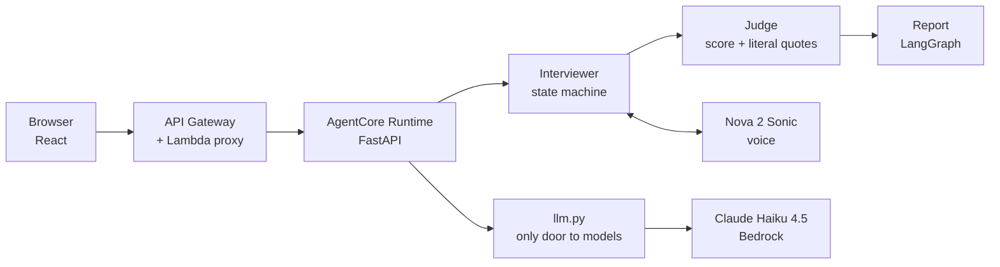

<p align="center">
  
</p>

<h1 align="center">MIA: Mock Interview Assistant</h1>

<p align="center">
  An AI job-interview simulator with a <b>calibrated judge</b>: every score quotes the candidate's own words.<br>
  Text and real-time voice · Claude Haiku 4.5 on Amazon Bedrock · Nova 2 Sonic · LangGraph · Terraform
</p>

---

A visitor picks one of 5 fictitious job cases, plays the candidate in a text or voice interview,
and gets a report with a score per competency, backed by literal quotes. A recruiter screen lists,
per case, who scored above the average, with an anonymous summary that supports a decision rather
than making it. A CLI runs the same pipeline on any fictitious CV and job description.

Portfolio project for Prompt Engineer / AI Engineer roles. The public AWS demo ran until
2026-11-17; everything still [runs locally](docs/running-locally.md).


<sub>Text mode, sped up. The interface is in Portuguese, the product's language.
Full walkthrough (1:36): <a href="https://github.com/nemofromdreamland/mia/releases/download/portfolio-media/demo-desktop.mp4">desktop</a> · <a href="media/demo-mobile.webm">mobile</a>.</sub>

## Results

| What | Number | Source |
| --- | --- | --- |
| Judge agreement with a blind human score (weighted kappa, test split) | **0.61 → 0.82** (prompt v1 → v2) | [evaluation](docs/evaluation.md) |
| Judge scores within ±1 of the human (test) | **76% → 100%** | [evaluation](docs/evaluation.md) |
| Score inflation on rambling answers | **+1.40 → +0.30** points | [evaluation](docs/evaluation.md) |
| Prompt-injection attacks that worked (30 attacks, 5 types) | **0%** | [security](docs/security.md) |
| Text cost per completed interview in production | **US$ 0.0587** (upper bound) | [costs](docs/costs.md) |
| Voice: time to first audio, median / p90 | **1.31 s / 1.49 s** (11 sessions) | [production summary](results/production_summary.md) |
| Production model calls with errors | **0 of 456** | [production summary](results/production_summary.md) |

Every number is printed by `uv run python scripts/doc_numbers.py` from files in this repo.

## How it works



- **The model writes, the code decides.** Phases, follow-up caps, time limits and the end of a
  voice answer are deterministic code; the model only words the next line. Quotes that do not
  appear literally in the answer are dropped before they reach a report.
- **One door to the models.** Only `src/mia/llm.py` imports a provider SDK. It validates every
  output against a Pydantic schema and logs every call (tokens, latency, cost) to `runs/*.jsonl`.
  Switching to Groq or Gemini is a config line.
- **Versioned prompts.** `prompts/<name>/v<N>.yaml` files are frozen once used, and every change
  is a new version with a changelog. See what worked and what got worse in the
  [prompt guide](docs/prompt-guide.md).
- **Serverless, nothing billed while idle**, all in Terraform. Read more in
  [architecture](docs/architecture.md).

## Method

1. **Golden set:** 70 synthetic answers (5 quality levels, plus rambling and paraphrased answers),
   generated by another model family (Groq `gpt-oss-120b`) so Claude never grades its own style.
2. **Blind labels:** the human scored every answer before seeing the judge, split 49 dev / 21 test.
3. **Error analysis on dev only.** v1 was lenient: it counted implicit criteria, gave 5s without
   proof, rewarded length and paraphrased quotes. v2 quotes before scoring, uses hard anchors and
   gives length no credit. Numbers are reported on test.
4. **Promptfoo** runs the real Python code (custom provider), not a copy of the prompts. CI
   replays recorded judge answers on every pull request.

## Security

A public demo with no login, running on paid models: visitor text is masked for personal data
(`pii.py`) and wrapped in delimiters as data; the recruiter screen never exposes visitor ids;
quotas, throttling, a kill switch and budget alerts cap the cost; production logs with visitor
text stay out of git. A repository audit script scans all of git history for secrets and personal
data before anything is published. Threat model: [security](docs/security.md).

## Limitations

- Small eval sets (21 test items, one human rater): read the numbers as a direction, not a
  benchmark.
- Synthetic answers. Real candidates, especially in voice, behave differently.
- Only Claude Haiku 4.5 was evaluated for production prompts. The Groq and Gemini comparison and
  the Promptfoo red-team were not run before the AWS account closed.
- Voice needs Amazon Nova 2 Sonic, and its cost is not stated because the price was never
  confirmed.
- No hosted demo now. A permanent text-only version is future work.

## Run it

```bash
uv sync
uv run pytest                                   # full suite, no model calls
uv run mia simulate --case prompt-engineer-jr   # needs Bedrock access
```

Web app, voice and running without AWS: [running locally](docs/running-locally.md).

## Docs

| Doc | For |
| --- | --- |
| [Architecture](docs/architecture.md) | Components, flows, data, infrastructure |
| [Evaluation](docs/evaluation.md) | Eval sets, metrics, results, limitations |
| [Prompt guide](docs/prompt-guide.md) | What worked, what got worse, rules of thumb |
| [Security](docs/security.md) | Threat model and repository audit |
| [Costs](docs/costs.md) | Prices, production and eval costs |
| [Running locally](docs/running-locally.md) | CLI, web app, voice, other providers |
| [ADRs](docs/adr/README.md) | One decision per file |

The project was built spec-first: every task has a spec, step-by-step commits and an evidence
file in [`specs/`](specs/). Internal docs (PRD, TRD, specs) are in Portuguese.
