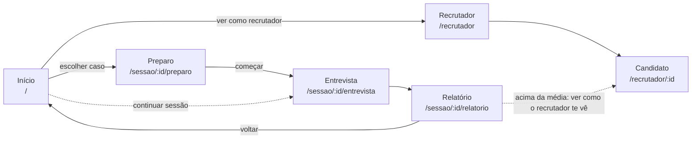
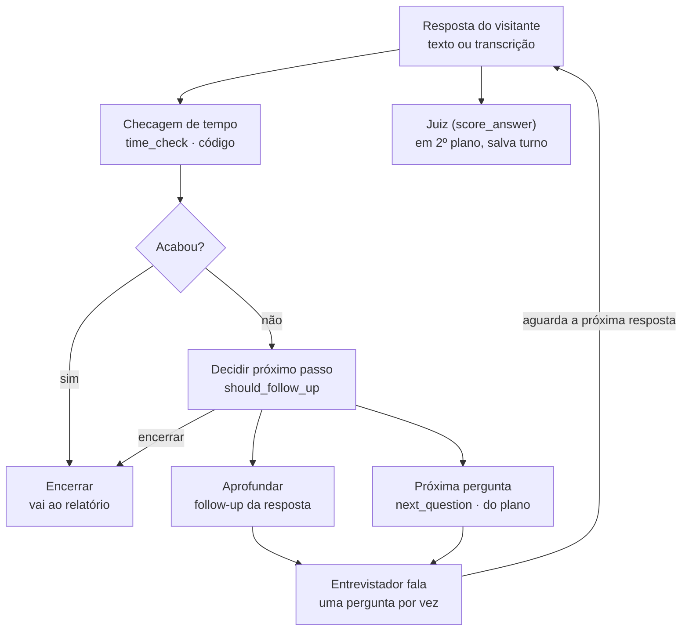

# MIA — App Flow

**MIA — Mock Interview Assistant** · atualizado em 15/11/2026

Documentos relacionados: [PRD](PRD.md) · [TRD](TRD.md) · [Backend Schema](BACKEND_SCHEMA.md) · [Design](design/README.md) · [Casos](CASES.md)

A web é uma demo pública sem login. Quem chega pode fazer dois papéis: **candidato** (escolhe um caso e faz a entrevista) ou **recrutador** (vê quem ficou acima da média de cada caso). O fluxo com CV avulso (fictício) existe só na CLI local.

## Mapa de telas

O caminho do candidato vai do Início ao Relatório passando por Preparo e Entrevista. O recrutador é um caminho paralelo, aberto a qualquer visitante, com dados anônimos.

## Telas

O plano de perguntas nunca é mostrado antes do fim da entrevista; o candidato vê só a triagem e as competências avaliadas.

| Tela | Rota | Objetivo | Mostra | Ações |
| --- | --- | --- | --- | --- |
| Início | `/` | Escolher um caso e ver o próprio histórico | Os 5 casos (vaga, empresa fictícia, nível, tipo de entrevista, quem você interpreta, duração); "Suas simulações neste navegador" com notas e gráfico de evolução; acesso à tela do recrutador | Escolher caso; continuar sessão; ver relatório; apagar sessão; ver como recrutador |
| Preparo | `/sessao/:id/preparo` | Mostrar a visão do recrutador simulado sobre o candidato do caso | Quem você interpreta, aderência, forças e pontos de atenção com citação do CV, palavras-chave faltando, competências avaliadas, duração | Começar entrevista; voltar |
| Entrevista | `/sessao/:id/entrevista` | Conduzir a conversa | Transcrição, pergunta atual, tempo decorrido | Responder; encerrar; (voz) silenciar microfone |
| Relatório | `/sessao/:id/relatorio` | Dar o feedback | Nota geral e por competência, critérios atendidos, citações, pontos a melhorar, resposta mais forte, transcrição; aviso se ficou acima da média do caso | Treinar o mesmo caso de novo; ver como o recrutador te vê; voltar ao início |
| Recrutador | `/recrutador` | Ver quem vale a próxima etapa | Filtro por caso, média do caso e número de entrevistas, lista de candidatos anônimos acima da média com nota, distância da média e uma frase de resumo | Abrir candidato; trocar de caso |
| Candidato | `/recrutador/:id` | Entender o desempenho de um candidato | Resumo, pontos fortes e de atenção com trechos das respostas, notas por competência, sugestão de próximo passo, transcrição | Voltar à lista |

## Fluxo 1: escolher um caso e se preparar

Criar a sessão não chama modelo: triagem e plano já vêm prontos do caso.

1. Na primeira visita, o front gera um `visitor_id` (UUID) e guarda no `localStorage`. Todas as chamadas levam o header `X-Visitor-Id`.
2. Início → `list_cases` mostra os 5 casos e `list_sessions` mostra as simulações deste navegador.
3. O visitante escolhe um caso → um diálogo mostra a vaga, quem ele vai interpretar, a duração e o aviso: "Suas respostas ficam anônimas e podem aparecer na tela do recrutador desta demo." → **Começar**.
4. `create_session {case_id, mode}`:
    1. confere se a demo está aberta e se há cota (do visitante e global);
    2. numera o candidato no caso;
    3. copia triagem e plano do caso e cria a sessão já em `ready`.
5. Tela de Preparo, na hora, com a triagem do caso.
6. **Começar entrevista** → `start_interview` → status `in_progress` → Entrevista com a primeira fala da MIA.

Se a cota acabou ou a demo está pausada, o diálogo mostra o motivo e o botão fica desabilitado (ver Estados).

## Fluxo 2: o loop de cada turno

O código decide o que é regra (tempo, limite de turnos, qual é a próxima pergunta do plano); o LLM rápido decide só se vale aprofundar. O juiz roda em paralelo e nunca atrasa a fala do entrevistador. Limite padrão: 2 aprofundamentos por pergunta. Durante a entrevista a API devolve só `PublicTurn` (sem nota), e recarregar a página restaura a transcrição pelo `get_session`.

## Fluxo 3: encerramento, relatório e resumo

A entrevista termina de três jeitos, e todos levam ao mesmo relatório.

| Gatilho | Quem decide | O que acontece |
| --- | --- | --- |
| Plano concluído | Entrevistador (`end_interview`) | Fala de encerramento e convite para perguntas do candidato |
| Tempo ou número máximo de turnos atingido | Código (`time_check`) | Entrevistador fecha educadamente na próxima fala |
| Visitante clica em **Encerrar** | Visitante | Confirmação; respostas dadas até ali são avaliadas |

Depois do encerramento:

1. Status muda para `scoring`; o front mostra "A MIA está avaliando suas respostas".
2. Grafo de relatório: garante nota para todo turno → agrega por competência → pontos a melhorar e respostas mais fortes → **resumo do candidato** para o recrutador.
3. Status `completed` → Relatório. Cada nota mostra critérios atendidos e citações; citação que não existe literalmente na resposta não é exibida.
4. Se a nota geral ficou acima da média do caso (com 3 ou mais entrevistas concluídas), o Relatório mostra: "Sua nota ficou acima da média deste caso." + link "Ver como o recrutador te vê".
5. O Início passa a mostrar a sessão com a nota geral e atualiza o gráfico de evolução.

## Fluxo 4: tela do recrutador

1. Início → **Ver como recrutador** → `/recrutador`.
2. `list_recruiter_candidates` (todos os casos ou um `case_id`) devolve, por caso, a média e o número de entrevistas concluídas, e a lista de candidatos acima da média.
3. Regras da lista:
    - com 3 ou mais entrevistas concluídas no caso: só quem ficou acima da média, do mais acima para o menos;
    - com menos de 3: todos os concluídos, com o aviso "Média ainda não calculada: menos de 3 entrevistas neste caso.";
    - cada linha: "Candidato N", caso, data, nota geral, "+0,6 acima da média", headline.
4. Abrir um candidato → `get_recruiter_candidate`: resumo em 3 a 4 frases, pontos fortes e de atenção com trechos literais das respostas, notas por competência, sugestão de próximo passo com o motivo e a transcrição completa.
5. Nada identifica o visitante: nem nome, nem `visitor_id`. A sugestão de próximo passo aparece com o aviso "Apoio à decisão. Quem decide é você."

## Fluxo 5: modo voz

A voz só troca a entrada e a saída; plano, ferramentas, juiz, relatório e resumo são os mesmos do modo texto. Esta camada entra apenas se o Sonic passar no teste da fase 0.

1. No diálogo do caso, o visitante escolhe "Voz". No Preparo, **Começar entrevista** pede permissão do microfone (com cancelamento de eco e recomendação de fone).
2. Front chama `POST /sessions/{id}/voice-url`; a Lambda confere dono, status e cota e devolve uma URL assinada do WebSocket, válida por 5 minutos.
3. Backend abre a sessão com o Nova 2 Sonic: prompt do entrevistador, voz em português e as mesmas ferramentas do modo texto.
4. Navegador envia áudio PCM 16 kHz em pedaços; recebe o áudio da MIA e a transcrição dos dois lados.
5. Quando o Sonic chama uma ferramenta, o backend executa no `interviewer.py`; `score_answer` roda em segundo plano.
6. O visitante pode interromper a MIA falando por cima; a tela mostra quem está falando e a transcrição ao vivo.
7. Cada turno é salvo só como texto; nenhum áudio é armazenado.
8. Encerramento segue o Fluxo 3.

**Se a conexão cair:** o front tenta reconectar uma vez; se falhar, oferece continuar a mesma sessão em modo texto a partir da última pergunta.

## Estados vazios, carregamento e erros

| Situação | Onde | O que o visitante vê |
| --- | --- | --- |
| Nenhuma simulação neste navegador | Início | Só os 5 casos, com uma frase explicando o MIA; a seção de histórico não aparece |
| Uma simulação concluída | Início | Histórico sem gráfico, com "A evolução aparece a partir da segunda simulação concluída." |
| Cota do visitante esgotada | Início / diálogo do caso | "Você já fez 5 simulações hoje. Volte amanhã para fazer mais." Botão Começar desabilitado; histórico e recrutador continuam abertos |
| Cota global esgotada | Início / diálogo do caso | "A demo atingiu o limite de hoje. Volte amanhã." |
| Demo pausada | Início | Faixa no topo: "A demo está pausada no momento. O histórico e a tela do recrutador continuam disponíveis." |
| Navegador sem `localStorage` (modo privado restrito) | Qualquer | O id vive só na memória da aba; aviso: "Seu histórico não será guardado neste navegador." |
| Resposta do entrevistador demorando | Entrevista | Indicador "MIA está escrevendo…"; depois de 15 s, opção de reenviar |
| Provedor fora do ar ou limite atingido | Entrevista | Backend tenta outro modelo; se não houver, pausa a sessão e permite continuar depois |
| Resposta vazia ou só "não sei" | Entrevista | Vazia: o front não envia. "Não sei": segue normal; o juiz dá nota baixa com justificativa |
| Tentativa de injection na resposta | Entrevista | Nada muda no comportamento; o turno é registrado para o conjunto D |
| Microfone negado | Entrevista (voz) | Explicação + opção de continuar em texto |
| Limite de turnos ou tempo | Entrevista | MIA encerra (Fluxo 3) |
| Caso sem entrevistas concluídas | Recrutador | "Ninguém concluiu este caso ainda." + link para fazer o caso |
| Menos de 3 entrevistas no caso | Recrutador | Todos os concluídos + aviso de média ainda não calculada |
| Ninguém acima da média | Recrutador | "Nenhum candidato acima da média neste caso por enquanto." |
| Candidato apagado pelo visitante | Candidato | "Este candidato não está mais disponível." + voltar à lista |
