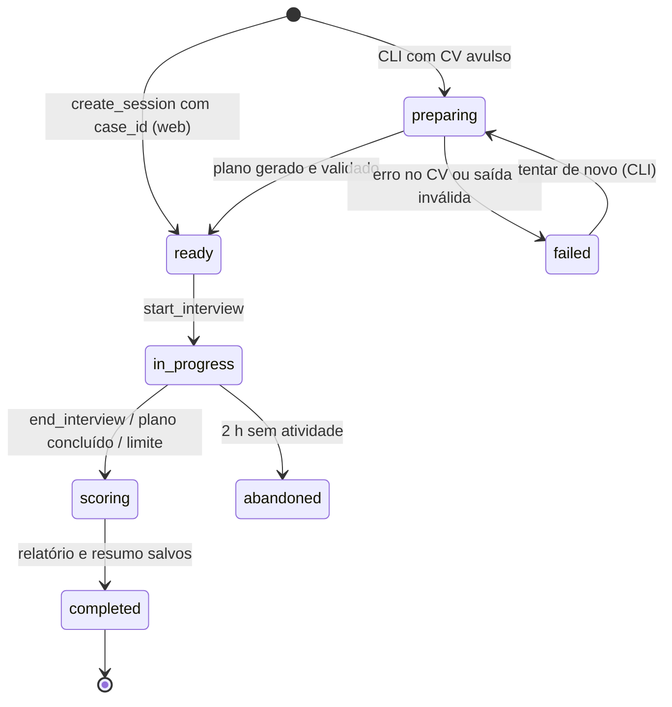

# MIA — Backend Schema

**MIA — Mock Interview Assistant** · atualizado em 15/11/2026

Documentos relacionados: [PRD](PRD.md) · [TRD](TRD.md) · [App Flow](APP_FLOW.md) · [Design](design/README.md) · [Casos](CASES.md)

## Visão geral

A web é uma demo pública sem login: o visitante é identificado por um id anônimo do navegador, escolhe um dos 5 casos e faz a entrevista; a tela do recrutador mostra, de forma anônima, quem ficou acima da média de cada caso. O estado quente (sessões, turnos, cotas) fica no DynamoDB; documentos grandes (relatório, resumo) ficam no S3; os casos ficam versionados no repositório; o histórico de chamadas a modelos fica em JSONL.

| Entidade | Onde mora | Relação |
| --- | --- | --- |
| Visitor | Navegador (`localStorage`), enviado no header `X-Visitor-Id` | tem muitas Sessions |
| Case | Repositório `cases/<case_id>/` (fixtures dentro do container) | tem um Screening e um InterviewPlan prontos; tem muitas Sessions |
| Session | DynamoDB `mia-sessions` | pertence a um Visitor e a um Case; tem muitos Turns, um Report e um CandidateSummary |
| Turn | DynamoDB `mia-turns` | pertence a uma Session; referencia uma Question; tem um AnswerScore |
| Report | S3 `report.json` + notas na Session | um por Session |
| CandidateSummary | S3 `summary.json` + `headline` na Session | um por Session; usado na tela do recrutador |
| Quota / contadores | DynamoDB `mia-meta` | cotas diárias e numeração de candidatos por caso |
| RunRecord | `runs/*.jsonl` (repositório) e CloudWatch | uma por chamada a modelo, ligada à Session quando houver |

**Convenções:** ids de sessão são ULID (ordenam por data); `visitor_id` é UUID v4 gerado no navegador; datas em ISO 8601 UTC; campos em inglês e `snake_case`; todo texto digitado pelo visitante é mascarado (`pii.py`) antes de ser salvo ou enviado a um modelo.

**Fluxo local (CLI):** `mia simulate --cv --job` continua aceitando CV e vaga avulsos (fictícios). Nesse caminho a sessão passa por `preparing` e usa `visitor_id = "local"`. A web não expõe esse fluxo.

## Ciclo de vida da sessão



Toda mudança de estado é um `UpdateItem` condicionado ao estado anterior. Uma falha em `scoring` volta a tentar a avaliação sem perder os turnos.

| Transição | Gatilho |
| --- | --- |
| → `ready` | `create_session` com `case_id`: copia triagem e plano das fixtures |
| → `preparing` | Só na CLI, com CV e vaga avulsos (fictícios) |
| `preparing` → `ready` / `failed` | Plano gerado e validado / erro (CLI) |
| `ready` → `in_progress` | `start_interview` |
| `in_progress` → `scoring` | `end_interview`, plano concluído ou limite atingido |
| `in_progress` → `abandoned` | 2 h sem nova resposta |
| `scoring` → `completed` | `Report` e `CandidateSummary` salvos |

## DynamoDB

Três tabelas on-demand.

**Tabela `mia-sessions`** · `PK = visitor_id` · `SK = session_id` (ULID)

| Atributo | Tipo | Descrição |
| --- | --- | --- |
| `visitor_id` | S | UUID v4 do navegador (`"local"` na CLI) |
| `session_id` | S | ULID |
| `case_id` | S | Caso escolhido (`null` na CLI) |
| `case_version` | N | Versão do caso usada (`case.yaml`) |
| `candidate_no` | N | Número sequencial anônimo dentro do caso ("Candidato 7") |
| `status` | S | `preparing` · `ready` · `in_progress` · `scoring` · `completed` · `failed` · `abandoned` |
| `persona` | S | `hr` · `technical` · `manager` (vem do caso) |
| `language` | S | `pt-BR` · `en-US` |
| `mode` | S | `text` · `voice` |
| `job_title` | S | Título da vaga do caso |
| `fit_score` | N | 0–100, da triagem do caso |
| `overall_score` | N | 1–5, do relatório (vazio até `completed`) |
| `competency_scores` | M | competência → nota média |
| `headline` | S | Frase do `CandidateSummary` (vazio até `completed`) |
| `current_question_id` | S | Pergunta atual do plano |
| `follow_ups_used` | N | Aprofundamentos na pergunta atual (máx. 2) |
| `turn_count` | N | Turnos até agora |
| `started_at` / `ended_at` | S | ISO 8601 |
| `prompt_versions` | M | prompt → versão usada |
| `error` | S | Mensagem curta quando `failed` |
| `created_at` / `updated_at` | S | ISO 8601 |

**GSI `by_case`** · `PK = case_id` · `SK = ended_at` · projeção: `session_id`, `visitor_id`, `candidate_no`, `status`, `overall_score`, `competency_scores`, `headline`, `ended_at`. Serve à tela do recrutador.

**Tabela `mia-turns`** · `PK = session_id` · `SK = turn_no` (N)

| Atributo | Tipo | Descrição |
| --- | --- | --- |
| `session_id` | S | Sessão dona do turno |
| `turn_no` | N | 1, 2, 3… |
| `question_id` | S | Pergunta do plano (ou do follow-up) |
| `interviewer_text` | S | Fala do entrevistador |
| `answer_text` | S | Resposta do visitante, mascarada |
| `is_follow_up` | BOOL | Se o turno foi um aprofundamento |
| `decision` | M | `ToolDecision` (ação + motivo) |
| `score` | M | `AnswerScore` (vazio até o juiz terminar) |
| `latency_ms` | N | Tempo até a fala do entrevistador |
| `created_at` | S | ISO 8601 |

**Tabela `mia-meta`** · `PK = pk` (S) · `SK = sk` (S) · TTL em `expires_at`

| `pk` | `sk` | Atributos | Uso |
| --- | --- | --- | --- |
| `quota#global` | `YYYY-MM-DD` | `count` | Sessões criadas no dia, todas as origens |
| `quota#visitor#<visitor_id>` | `YYYY-MM-DD` | `count` | Sessões criadas no dia por visitante |
| `counter#case#<case_id>` | `candidate_no` | `value` | Próximo número de candidato do caso |
| `config` | `demo` | `open` (BOOL) | Interruptor da demo (`false` pausa novas sessões) |

Os itens de cota têm `expires_at` de 2 dias (TTL do DynamoDB apaga sozinho).

**Padrões de acesso**

| Necessidade | Operação |
| --- | --- |
| Listar sessões do visitante, mais novas primeiro | `Query` em `mia-sessions` por `visitor_id`, `ScanIndexForward=false` |
| Abrir uma sessão | `GetItem` (`visitor_id`, `session_id`) |
| Atualizar status e estado da entrevista | `UpdateItem` condicionado ao `status` atual |
| Listar turnos em ordem | `Query` em `mia-turns` por `session_id` |
| Gravar nota do juiz | `UpdateItem` no turno (`score`) |
| Listar sessões concluídas de um caso (recrutador) | `Query` no GSI `by_case` por `case_id`, filtro `status = completed` |
| Abrir candidato no recrutador | `Query` no GSI `by_case` (`case_id`) até achar o `session_id`, depois `GetItem` |
| Checar e somar cota | `UpdateItem` em `mia-meta` com `ADD count 1` e condição `count < limite` |
| Numerar candidato | `UpdateItem` em `counter#case#<case_id>` com `ADD value 1`, `ReturnValues=UPDATED_NEW` |
| Apagar sessão | `DeleteItem` + `BatchWriteItem` dos turnos + remoção do prefixo no S3 |

## S3

Bucket privado `mia-data-<conta>`, criptografia padrão, acesso só pelas roles do backend.

```
mia-data-<conta>/
└── sessions/<session_id>/
    ├── report.json          # Report
    └── summary.json         # CandidateSummary
```

Sessões da CLI guardam também `cv_masked.txt`, `job.txt`, `screening.json` e `plan.json`. Sessões da web não precisam: triagem e plano vêm do caso.

| Regra | Valor |
| --- | --- |
| Ciclo de vida | Objetos em `sessions/` expiram em 30 dias |
| Acesso público | Bloqueado (Block Public Access) |
| Frontend | Bucket separado (`mia-web-<conta>`), servido só pelo CloudFront |

## Schemas Pydantic

Ficam em `src/mia/schemas.py` e são a fonte única para saídas de LLM, DynamoDB e API.

```python
from datetime import datetime
from typing import Literal
from pydantic import BaseModel, Field

Persona = Literal["hr", "technical", "manager"]
Language = Literal["pt-BR", "en-US"]
Mode = Literal["text", "voice"]
Level = Literal["internship", "junior", "mid"]
SessionStatus = Literal["preparing", "ready", "in_progress", "scoring",
                        "completed", "failed", "abandoned"]
Phase = Literal["opening", "projects", "technical", "behavioral",
                "candidate_questions", "closing"]

# ---------- Casos ----------
class Case(BaseModel):
    case_id: str
    title: str
    company: str
    level: Level
    persona: Persona
    language: Language = "pt-BR"
    blurb: str                       # a vaga em uma frase
    candidate_blurb: str             # quem o visitante interpreta
    estimated_minutes: int
    version: int

class CaseSummary(BaseModel):        # o que GET /cases devolve (sem CV, sem plano)
    case_id: str
    title: str
    company: str
    level: Level
    persona: Persona
    blurb: str
    candidate_blurb: str
    estimated_minutes: int
    completed_sessions: int          # quantas pessoas já fizeram

# ---------- Preparação ----------
class Evidence(BaseModel):
    point: str
    cv_quote: str                    # deve existir literalmente no CV

class Screening(BaseModel):
    job_title: str
    fit_score: int = Field(ge=0, le=100)
    strengths: list[Evidence] = Field(min_length=1, max_length=5)
    concerns: list[Evidence] = Field(min_length=1, max_length=5)
    missing_keywords: list[str]
    competencies: list[str] = Field(min_length=3, max_length=6)

class Question(BaseModel):
    id: str
    phase: Phase
    competency: str
    text: str
    purpose: str
    look_for: list[str] = Field(min_length=3, max_length=4)
    follow_ups: list[str] = Field(max_length=3)
    targets_concern: str | None = None

class InterviewPlan(BaseModel):
    persona: Persona
    language: Language
    estimated_minutes: int = Field(ge=5, le=45)
    questions: list[Question] = Field(min_length=4, max_length=12)

# ---------- Entrevista ----------
class ToolDecision(BaseModel):
    action: Literal["follow_up", "next_question", "end"]
    follow_up_text: str | None = None
    reason: str

class AnswerScore(BaseModel):
    score: int = Field(ge=1, le=5)
    criteria_met: list[str]
    evidence_quotes: list[str]
    justification: str
    quotes_verified: bool | None = None  # preenchido pelo código

class Turn(BaseModel):
    session_id: str
    turn_no: int
    question_id: str
    interviewer_text: str
    answer_text: str | None = None
    is_follow_up: bool = False
    decision: ToolDecision | None = None
    score: AnswerScore | None = None
    latency_ms: int | None = None
    created_at: datetime

class PublicTurn(BaseModel):
    """Turno como o front vê DURANTE a entrevista: sem nota, sem decisão, sem marca de aprofundamento."""
    turn_no: int
    question_id: str
    interviewer_text: str
    answer_text: str | None = None
    created_at: datetime

# ---------- Relatório ----------
class CompetencyScore(BaseModel):
    competency: str
    score: float = Field(ge=1, le=5)
    summary: str

class Improvement(BaseModel):
    question_id: str
    issue: str
    stronger_answer: str

class Report(BaseModel):
    overall_score: float = Field(ge=1, le=5)
    competencies: list[CompetencyScore]
    strengths: list[str]
    improvements: list[Improvement]

# ---------- Recrutador ----------
class SummaryPoint(BaseModel):
    point: str
    answer_quote: str                # deve existir literalmente numa resposta

class CandidateSummary(BaseModel):
    headline: str = Field(max_length=140)  # uma frase
    summary: str                     # 3 a 4 frases sobre o desempenho
    strengths: list[SummaryPoint] = Field(min_length=1, max_length=3)
    concerns: list[SummaryPoint] = Field(min_length=1, max_length=3)
    suggested_next_step: Literal["advance", "advance_with_caution", "not_now"]
    next_step_reason: str

class CaseStats(BaseModel):
    case_id: str
    completed_sessions: int
    average_score: float | None      # None com menos de 3 sessões concluídas

class RecruiterCandidateRow(BaseModel):
    session_id: str
    case_id: str
    candidate_no: int
    ended_at: datetime
    overall_score: float
    delta_vs_case_avg: float | None  # overall_score - average_score
    headline: str

# ---------- Sessão ----------
class Session(BaseModel):
    visitor_id: str
    session_id: str
    case_id: str | None = None
    case_version: int | None = None
    candidate_no: int | None = None
    status: SessionStatus
    persona: Persona
    language: Language
    mode: Mode
    job_title: str | None = None
    fit_score: int | None = None
    overall_score: float | None = None
    competency_scores: dict[str, float] = {}
    headline: str | None = None
    current_question_id: str | None = None
    follow_ups_used: int = 0
    turn_count: int = 0
    prompt_versions: dict[str, int] = {}
    error: str | None = None
    created_at: datetime
    updated_at: datetime
    started_at: datetime | None = None
    ended_at: datetime | None = None
```

**Validações feitas pelo código, não pelo LLM:** `cv_quote`, `evidence_quotes` e `answer_quote` existem literalmente no texto de origem; `criteria_met` é subconjunto de `look_for`; `competency` de cada pergunta existe em `Screening.competencies`; `follow_up_text` presente quando a ação é `follow_up`; o `CandidateSummary` não menciona nome, gênero, idade, origem ou qualquer dado pessoal (checagem por regex + instrução no prompt).

## Tela do recrutador: regras

- **Média do caso:** média de `overall_score` das sessões `completed` do caso. Só existe com 3 ou mais sessões concluídas.
- **Quem aparece:** com média calculada, só sessões com `overall_score` maior que a média do caso. Sem média (menos de 3), aparecem todas as concluídas, com o aviso de que a média ainda não existe.
- **Anonimato:** o candidato é "Candidato {candidate_no}" do caso. O `visitor_id` nunca sai pela API do recrutador.
- **Resumo:** gerado pelo prompt `candidate_summary` no fim do grafo de relatório, a partir das respostas e das notas. Baseado só no desempenho na entrevista. `suggested_next_step` é apoio à decisão, nunca decisão.
- **Ordenação:** maior `delta_vs_case_avg` primeiro; empate pela sessão mais recente.

## API

Uma camada de serviço com 11 operações e dois adaptadores: rotas REST (o que o front chama, via API Gateway) e um despachante no contrato do AgentCore Runtime (`POST /invocations` com campo `action`, mais `GET /ping`). O API Gateway chama uma Lambda proxy, que repassa ao AgentCore com credenciais IAM. Detalhes no TRD.

**Identificação:** toda requisição leva `X-Visitor-Id: <uuid v4>`. O front gera o id na primeira visita e guarda em `localStorage` (`mia:visitor_id`). O backend valida o formato e usa esse valor como `visitor_id`; nunca aceita `visitor_id` no corpo. Sem header válido → `invalid_input`. As rotas do recrutador não dependem do visitante.

| Operação | REST | Action no AgentCore | Entrada | Saída |
| --- | --- | --- | --- | --- |
| Listar casos | `GET /cases` | `list_cases` | — | `CaseSummary[]` |
| Criar sessão a partir de um caso | `POST /sessions` | `create_session` | `{case_id, mode}` | `201` + `Session` em `ready` |
| Listar minhas sessões | `GET /sessions` | `list_sessions` | — | `Session[]` (resumo) do visitante |
| Ver sessão / status | `GET /sessions/{id}` | `get_session` | — | `Session`; + `Screening` e `Case` quando `ready`; + `turns: PublicTurn[]` quando `in_progress` |
| Começar entrevista | `POST /sessions/{id}/start` | `start_interview` | — | primeiro `PublicTurn` |
| Enviar resposta | `POST /sessions/{id}/turns` | `send_answer` | `{answer_text}` | próximo `PublicTurn` ou `{ended: true}` |
| Encerrar | `POST /sessions/{id}/end` | `end_interview` | — | `{status: "scoring"}` |
| Ver relatório | `GET /sessions/{id}/report` | `get_report` | — | `Report` + `Turn[]` completos + `is_above_case_avg`, só em `completed` |
| Apagar sessão | `DELETE /sessions/{id}` | `delete_session` | — | `204` |
| Recrutador: candidatos acima da média | `GET /recruiter/candidates?case_id=` | `list_recruiter_candidates` | `case_id` opcional | `{stats: CaseStats[], candidates: RecruiterCandidateRow[]}` |
| Recrutador: detalhe do candidato | `GET /recruiter/candidates/{session_id}` | `get_recruiter_candidate` | — | `RecruiterCandidateRow` + `CandidateSummary` + `Report` + `Turn[]` (sem `visitor_id`) |

**Regras:**

- `create_session` checa, nesta ordem: demo aberta (`config/demo.open`), cota global do dia (100 sessões), cota do visitante no dia (5 sessões). Depois numera o candidato e copia triagem e plano do caso.
- Antes de `completed`, turnos só saem como `PublicTurn` (nunca `score`, `decision` ou `is_follow_up`), e o plano nunca sai pela API.
- `send_answer` só é aceito em `in_progress`; respostas têm limite de 4.000 caracteres; cada sessão tem no máximo 30 turnos e 45 minutos.
- O recrutador só vê sessões `completed`. Uma sessão apagada pelo visitante some da tela do recrutador.
- O API Gateway limita requisições por segundo (throttling); as cotas do DynamoDB limitam sessões por dia.

**Exemplo de chamada ao AgentCore (feita pela Lambda proxy)**

```json
POST /invocations
{
  "action": "send_answer",
  "visitor_id": "3f8b2c1e-7d4a-4f6b-9a2e-1c5d8e9f0a7b",
  "session_id": "01JD3Y7K2M4N8P0Q6R5S1T9V3W",
  "payload": { "answer_text": "Eu usaria um cross-encoder para reranking porque..." }
}
```

O `visitor_id` no corpo do `/invocations` é preenchido pela proxy a partir do header validado; o navegador nunca fala direto com o AgentCore.

## WebSocket (modo voz)

O navegador fala um protocolo próprio e simples com o backend; só o backend conhece os eventos do Nova 2 Sonic. Formatos de áudio seguem o exemplo oficial do Sonic e são confirmados na fase 0.

Conexão: o front chama `POST /sessions/{id}/voice-url` (com `X-Visitor-Id`); uma Lambda confere dono, status (`ready` ou `in_progress`) e cota, e devolve uma URL assinada (SigV4) do WebSocket do AgentCore, válida por 5 minutos.

| Direção | Evento | Payload | Quando |
| --- | --- | --- | --- |
| cliente → servidor | `session.start` | `{session_id}` | Logo após conectar |
| cliente → servidor | `audio.chunk` | `{data}` (PCM 16 kHz mono, base64) | Enquanto o microfone está aberto |
| cliente → servidor | `audio.mute` | `{muted: bool}` | Usuário silencia/libera o microfone |
| cliente → servidor | `session.end` | `{}` | Usuário clica em Encerrar |
| servidor → cliente | `audio.output` | `{data}` (PCM, base64) | Fala do entrevistador |
| servidor → cliente | `transcript` | `{role: "interviewer" \| "candidate", text, final: bool}` | Transcrição ao vivo |
| servidor → cliente | `interrupted` | `{}` | Usuário falou por cima |
| servidor → cliente | `state` | `{phase, question_no, elapsed_s}` | Mudança de pergunta ou fase |
| servidor → cliente | `turn.saved` | `{turn_no}` | Turno gravado |
| servidor → cliente | `session.ended` | `{status: "scoring"}` | Fim da entrevista |
| servidor → cliente | `error` | `{code, message}` | Erro (ver Erros) |

O áudio só passa pelo servidor em memória; o que é gravado é o `transcript` final de cada turno.

## Execuções, prompts e datasets

**RunRecord** · uma linha por chamada em `runs/<data>_<experimento>.jsonl`

```python
class RunRecord(BaseModel):
    run_id: str
    experiment: str | None
    session_id: str | None
    prompt_name: str
    prompt_version: int
    provider: Literal["bedrock", "gemini", "groq"]
    model: str
    params: dict
    input_hash: str
    input: dict                      # variáveis mascaradas
    output_raw: str
    output_parsed: dict | None
    json_valid_first_try: bool | None  # None = não se aplica (saída em texto)
    repaired: bool | None              # None = não se aplica (saída em texto)
    input_tokens: int
    output_tokens: int
    latency_ms: int
    cost_usd: float
    error: str | None
    created_at: datetime
```

`json_valid_first_try` e `repaired` só têm sentido em chamadas com `output_schema`. Em saída de texto livre (entrevistador, smoke test) ficam `None`: gravar `false` contaria como "JSON inválido" e derrubaria a taxa de JSON válido sem motivo. As métricas contam só os registros em que os campos não são `None`. (Decidido na spec 0.5.)

**Prompt** · `prompts/<nome>/v<N>.yaml`, validado ao carregar

| Campo | Tipo | Obrigatório |
| --- | --- | --- |
| `name`, `version` | str, int | sim |
| `model` | `provedor:modelo` (sobrescrevível por config) | sim |
| `params` | dict | sim |
| `output_schema` | nome de um modelo de `schemas.py` | quando há saída estruturada |
| `system`, `user` | template com `{variáveis}` | sim |
| `changelog` | str | sim a partir da v2 |

**Golden set (conjunto A)** · `evals/datasets/judge_golden.jsonl`

```python
class GoldenItem(BaseModel):
    item_id: str
    question: Question
    answer_text: str
    variant: Literal["level_5", "level_4", "level_3", "level_2", "level_1",
                     "rambling", "paraphrase"]
    paraphrase_of: str | None
    human_score: int = Field(ge=1, le=5)
    split: Literal["dev", "test"]
    generated_by: str
```

Os conjuntos B, C e D seguem o mesmo padrão: um JSONL por conjunto, com entrada, esperado e `split`. O conjunto C usa os 5 casos de `cases/`.

## Erros e validação

Todo erro sai no formato `{"error": {"code": "...", "message": "...", "retryable": bool}}`.

| Código | HTTP | Quando | Recuperável |
| --- | --- | --- | --- |
| `not_found` | 404 | Sessão, caso ou candidato não existe (ou sessão é de outro visitante) | Não |
| `invalid_input` | 422 | `X-Visitor-Id` ausente ou inválido, `case_id` desconhecido, resposta acima de 4.000 caracteres | Não |
| `invalid_state` | 409 | Operação fora do status permitido | Não |
| `session_limit` | 409 | 30 turnos ou 45 minutos atingidos | Não |
| `quota_exceeded` | 429 | Cota diária do visitante (5) ou global (100) atingida | Não (volta amanhã) |
| `demo_paused` | 503 | Interruptor da demo desligado | Não |
| `llm_invalid_output` | 502 | Saída do modelo falhou no schema depois de 1 reparo | Sim |
| `provider_unavailable` | 503 | Provedor fora do ar ou limite; tenta o modelo reserva antes | Sim |
| `internal` | 500 | Qualquer outro erro | Sim |

**Pipeline de validação de cada saída de LLM**

1. Parse do JSON → registra `json_valid_first_try`.
2. Se falhar: uma tentativa de reparo (reenvio com o erro do Pydantic) → registra `repaired`.
3. Validação do schema Pydantic.
4. Checagens de código: citações literais, `criteria_met` dentro de `look_for`, competências existentes, resumo sem dados pessoais.
5. Se uma checagem falhar, o item é descartado ou marcado (`quotes_verified: false`); nada inventado chega ao usuário.
6. Ainda inválido → `llm_invalid_output`, e o caso entra no dataset de regressão.
