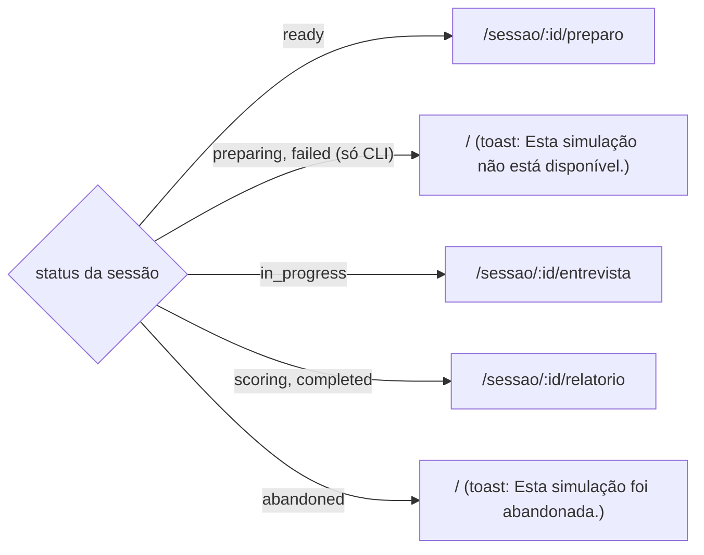
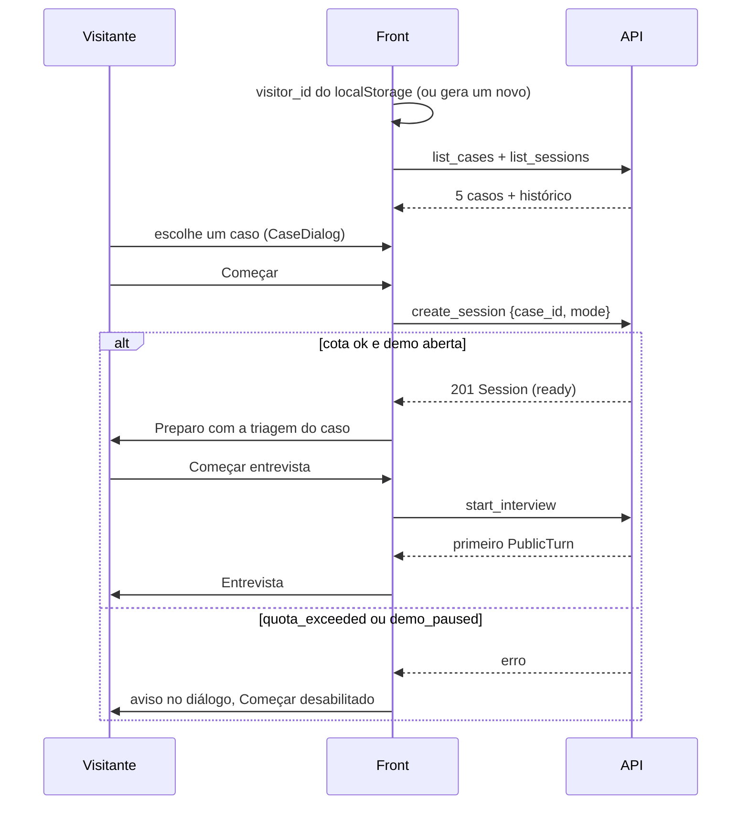
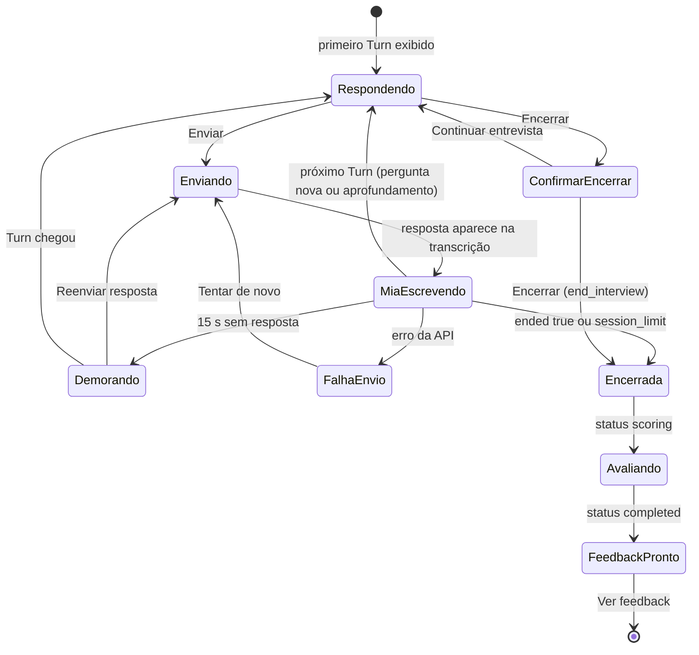
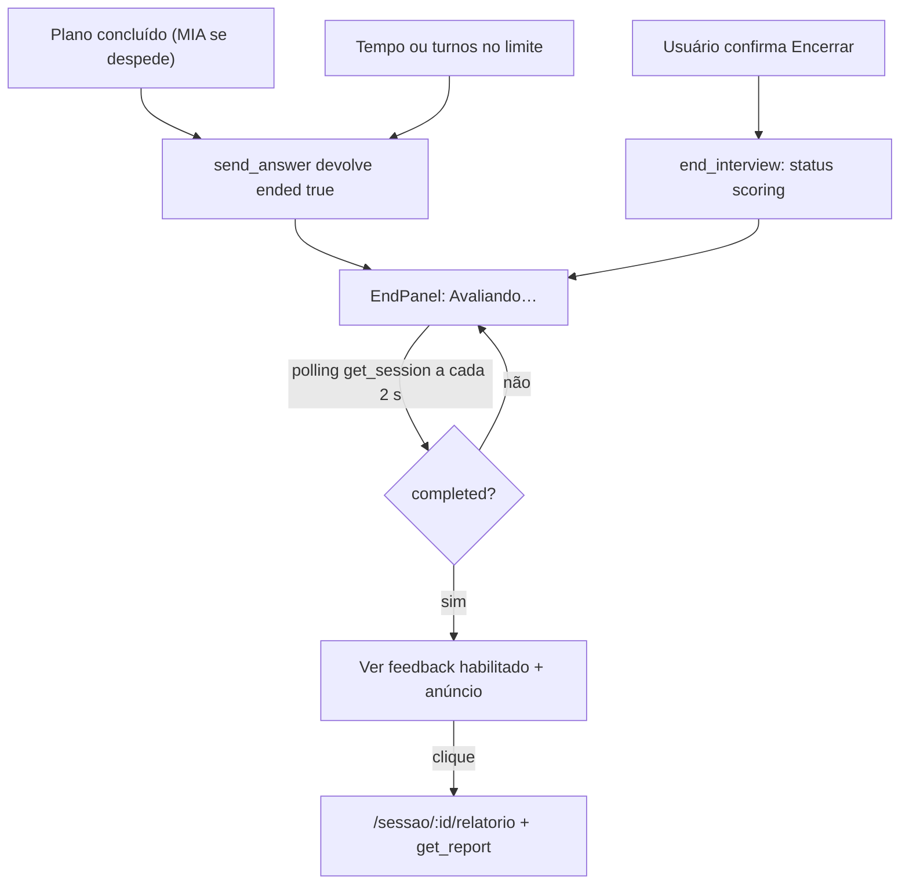

# MIA — Design UX/UI

**MIA — Mock Interview Assistant** · Documento de design de interface · 15/11/2026

Documentos relacionados: [PRD](PRD.md) · [App Flow](APP_FLOW.md) · [Backend Schema](BACKEND_SCHEMA.md) · [Casos](CASES.md) · [Implementation Plan](IMPLEMENTATION_PLAN.md)

> **Atualização de 15/11:** a web virou uma demo pública sem login. Saíram Login, Painel e Nova simulação; entraram Início (5 casos prontos + histórico do navegador), Recrutador e Candidato. Seções alteradas: decisões, 2.5, 2.7, 4.2, 5.1, 5.3, 5.4, 5.7, 5.30–5.33, 6 (cabeçalho), 6.1, 6.4, 6.6, 6.7, 6.8, 7.1, 7.2, 9, 10, 11, 12, 13 e 14.

Este documento é a referência visual e de interação do frontend (tarefas 3.6, 3.7 e 3.8). Ele não cria requisito novo: telas, rotas e operações vêm do `APP_FLOW.md` e do `BACKEND_SCHEMA.md`. Onde a API não entrega um dado que a tela precisa, a decisão do front está na seção [13. Lacunas da API](#13-lacunas-da-api-e-decisões-do-front). Em conflito, vale a ordem de fonte da verdade do `AGENTS.md`.

**Decisões fechadas nesta versão**

| Tema | Decisão |
| --- | --- |
| Biblioteca de UI | Tailwind CSS v4 + shadcn/ui + ícones Lucide |
| Gráficos | Recharts (só no Início) |
| Tema | Só escuro por enquanto (`<html class="dark">` fixo); claro depois, sem mexer em componentes |
| Direção visual | "Ata de entrevista": papel e tinta no escuro, marca-texto para evidências, rubrica ✓ só no Relatório |
| Entrevistadora | Sempre se chama **MIA**; a persona vira rótulo ("MIA · Entrevista técnica") |
| Nota durante a entrevista | Nunca aparece. Nem nota, nem ✓, nem reação do mascote |
| Fim da entrevista | Tela de encerramento na mesma rota, com botão **Ver feedback** quando o relatório fica pronto |
| Voz da interface | MIA fala em primeira pessoa só na conversa e no conteúdo do Relatório; o resto é neutro |
| Evolução no Início | Só a nota geral entre sessões; evolução por competência só entre tentativas da mesma vaga |
| Mobile | Desktop primeiro, usável a partir de 375 px |
| Acesso | Sem login. Visitante anônimo (`X-Visitor-Id`), 5 casos prontos, tela do recrutador aberta com dados anônimos |
| Telas da web | Início, Preparo, Entrevista, Relatório, Recrutador, Candidato |
| Mascote | MIA: esfera verde fosca com dois olhos, em leve 3D, sem boca |

---

## 1. Princípios de UX

1. **Foco total na conversa.** Na Entrevista só existem a conversa, a pergunta atual, o tempo e o botão Encerrar. Sem menu, sem painel lateral, sem dicas.
2. **Nada de nota durante a entrevista.** O juiz roda em segundo plano e o resultado só aparece depois do encerramento. O mascote nunca reage à qualidade da resposta: a expressão dele muda só pelo estado da conversa (parada, pensando, falando, ouvindo).
3. **Sem spoiler do plano.** Perguntas, total de perguntas, fases e critérios (`look_for`) nunca aparecem antes do fim. O Preparo mostra só a triagem e as competências avaliadas.
4. **Feedback honesto, com evidência.** Toda nota vem com critérios atendidos, justificativa e trechos literais. Marca-texto é sempre a palavra do usuário (do CV ou da resposta). Citação que não existe literalmente no texto de origem não é exibida.
5. **Calma sob pressão.** Nota não tem cor de semáforo, o relógio não pisca, nada pula na tela. Vermelho aparece só em erro de sistema, nunca para avaliar o candidato.

### Proibido (é o que dá "cara de IA")

- Gradiente roxo ou azul, brilho (glow), vidro fosco, fundo com manchas, neon.
- Ícone de estrelinhas (`Sparkles`), a palavra "IA" como enfeite, robô, esfera brilhante pulsando.
- O visual padrão do shadcn sem trocar nada: Inter, zinc, cards `rounded-2xl` com sombra em tudo.
- Bolhas de chat, caixa de texto flutuando, texto aparecendo palavra por palavra.
- Medidor circular, gradiente do vermelho ao verde, confete, medalha, sequência de dias.
- Emoji, exclamação, "Desbloqueie", "Potencialize", "jornada", "com sucesso", "por favor".

---

## 2. Identidade visual

### 2.1 Tom de voz

A interface fala como alguém que já entrevistou muita gente: frases curtas, diretas, sem enfeite e sem bajulação. Trata o usuário por "você".

| Quem fala | Onde | Pessoa | Exemplo |
| --- | --- | --- | --- |
| MIA | Falas da entrevista, textos do Relatório gerados pelo modelo | 1ª pessoa ("eu") | "Me conta como você mediu a qualidade da recuperação." |
| Interface | Botões, títulos, erros, estados, Início, Recrutador | Neutra, 2ª pessoa para o usuário | "Não foi possível enviar sua resposta. Tente de novo." |
| Interface falando da MIA | Indicadores | 3ª pessoa, feminino | "MIA está escrevendo…" |

Regras de texto:

- Botões: verbo no infinitivo, de 1 a 3 palavras, sem ponto ("Começar entrevista").
- Títulos e rótulos sem ponto final; textos de apoio e estados vazios com ponto.
- Reticências (`…`, caractere único) só para algo em andamento ("Enviando…").
- Erros dizem o que houve e o que fazer, sem "Erro:" no começo e sem código técnico.
- Números no formato brasileiro: `3,8`, `4.000`, datas `15/11/2026`.

### 2.2 Paleta (tema escuro, "grafite quente")

Contraste medido contra o fundo `#161513` (WCAG 2.1).

| Token | Hex | Uso | Contraste |
| --- | --- | --- | --- |
| `background` | `#161513` | Fundo da página | — |
| `card` | `#1F1D1A` | Cards, campos, painéis | — |
| `surface-raised` | `#26241F` | Popover, toast, tooltip, skeleton | — |
| `hover` | `#2A2723` | Hover de botão ghost e linha de tabela | — |
| `border` | `#2E2B27` | Divisórias e bordas de card (decorativas) | 1,3:1 |
| `border-strong` | `#403C36` | Borda de botão secundário, divisória forte | 1,7:1 |
| `input` | `#716B61` | Contorno de campo, checkbox e radio (precisa de 3:1) | 3,5:1 |
| `foreground` | `#ECE7DD` | Texto principal, falas da MIA | 14,8:1 |
| `foreground-soft` | `#D6D0C4` | Respostas do usuário, texto longo | 11,9:1 |
| `muted-foreground` | `#A8A196` | Texto secundário, rótulos, eixos | 7,1:1 |
| `placeholder` | `#8C857A` | Placeholder dentro de campo (`card`) | 4,6:1 no `card` |
| `mia` | `#8CC7A6` | Identidade da MIA, foco, ✓, linha do gráfico | 9,4:1 |
| `mia-strong` | `#A6D6BB` | Hover de link verde | 11,3:1 |
| `mia-muted` | `#1E2C25` | Fundo de item selecionado (persona) | texto `mia` 7,5:1 |
| `mia-ink` | `#12211A` | Olhos do mascote | 8,6:1 no verde |
| `primary` | `#ECE7DD` | Fundo do botão principal (tinta clara) | texto `#161513` 14,8:1 |
| `primary-hover` | `#F7F3EA` | Hover do botão principal | — |
| `highlight` | `#4A3F1E` | Fundo do marca-texto | texto `highlight-foreground` 8,4:1 |
| `highlight-foreground` | `#F5E6B8` | Texto marcado | — |
| `warning` | `#E2B866` | Avisos (vaga curta, demorando, tempo acabando) | 9,8:1 |
| `warning-muted` | `#2E2616` | Fundo de aviso | texto `warning` 8,0:1 |
| `danger` | `#EE9A8A` | Erros de sistema e ações de apagar | 8,4:1 |
| `danger-muted` | `#3A1F1A` | Fundo de erro | texto `danger` 6,9:1 |

### 2.3 Regras de cor

- **Verde é a MIA.** Rótulo "MIA ·", mascote, ✓ dos critérios, sugestão de resposta mais forte (borda), anel de foco e linha do gráfico. Nada mais é verde.
- **Marca-texto é a palavra do usuário.** `highlight` aparece só em trechos literais do CV (Preparo) ou da resposta (Relatório).
- **Borda verde à esquerda é a palavra da MIA** (sugestão de resposta mais forte). Nunca usa marca-texto.
- **Notas não têm cor de qualidade.** A rubrica 1–5 e a aderência 0–100 usam sempre `mia` no preenchimento e `border-strong` no vazio. O significado vem do número e do rótulo em texto.
- **Vermelho (`danger`) só para erro de sistema e para apagar.** Nunca para nota baixa.
- Cor nunca é o único sinal: status tem texto, persona no gráfico tem formato, rubrica tem número.

### 2.4 Tipografia

| Família | Pacote | Uso |
| --- | --- | --- |
| Newsreader (serifa) | `@fontsource-variable/newsreader` | Falas da MIA, títulos de página e seção, logotipo |
| IBM Plex Sans | `@fontsource/ibm-plex-sans` (400, 500) | Interface, respostas, textos |
| IBM Plex Mono | `@fontsource/ibm-plex-mono` (400, 500) | Rótulos em caixa alta, números, relógio, palavras-chave |

Pesos permitidos: 400 e 500. Nada de 600 ou 700. Números sempre com `tabular-nums`.

| Estilo | Classe | Família | Tamanho / altura de linha | Peso | Uso |
| --- | --- | --- | --- | --- | --- |
| Display | `text-display` | Mono | 48 / 52 px (mobile 40 / 44) | 500 | Nota geral, aderência |
| Título de página | `text-h1` | Serifa | 32 / 40 px (mobile 26 / 34) | 500 | H1 de cada tela |
| Título de seção | `text-h2` | Serifa | 22 / 30 px | 500 | H2 |
| Título de card | `text-h3` | Sans | 16 / 24 px | 500 | Nome de competência, título de card |
| Fala da MIA | `fala` | Serifa | 20 / 30 px (mobile 18 / 28) | 400 | Perguntas da entrevista |
| Resposta | `text-answer` | Sans | 16 / 26 px | 400 | Respostas do usuário, texto longo |
| Corpo | `text-body` | Sans | 15 / 24 px | 400 | Padrão da interface |
| Pequeno | `text-small` | Sans | 13 / 20 px | 400 | Meta, ajuda, contadores |
| Rótulo | `label` | Mono | 12 / 16 px, `letter-spacing: 0.06em`, caixa alta | 500 | "MIA · ENTREVISTA TÉCNICA", "VOCÊ", cabeçalhos de tabela |

Nenhum texto abaixo de 12 px.

### 2.5 Espaçamento e grade

- Base de 4 px. Escala usada: 4, 8, 12, 16, 24, 32, 48, 64 px (`1, 2, 3, 4, 6, 8, 12, 16` no Tailwind).
- Larguras máximas de conteúdo:
  - Início e Recrutador: 1040 px (`max-w-[1040px]`).
  - CaseDialog: 520 px.
  - Preparo, Relatório e Candidato: 760 px.
  - Entrevista (coluna da transcrição): 680 px.
- Margem lateral: 24 px no desktop, 16 px no celular.
- Entre seções: 48 px. Entre itens de uma lista: 16 px. Entre falas da transcrição: 32 px.

### 2.6 Raios, bordas e sombras

| Elemento | Raio |
| --- | --- |
| Botões, campos, badges, chips | 6 px (`rounded-md`, `--radius: 0.375rem`) |
| Cards, diálogos, dropzone | 8 px (`rounded-lg`) |
| Marca-texto | 2 px |
| Quadradinhos da rubrica | 2 px |
| Botão de microfone | circular |

- Bordas: 1 px, `border` para separar e `input` para contorno de controle.
- Sombras: nenhuma em card. A elevação vem da cor da superfície mais a borda. Só diálogo, toast e tooltip usam `0 8px 24px rgba(0,0,0,0.45)`.

### 2.7 Ícones

Lucide (`lucide-react`), traço de 1,5 px, 16 px dentro de botões e 20 px soltos, cor herdada do texto. Lista fechada:

| Ícone | Uso |
| --- | --- |
| `Upload`, `FileText`, `X` | Upload do CV (não usado na web desde 15/11) |
| `Users`, `Code2`, `Briefcase` | Personas RH, técnica e gestão |
| `Check` | Critério atendido, persona selecionada, etapa concluída |
| `Loader2` (girando) | Carregando |
| `Clock` | Duração no Preparo |
| `ArrowLeft` | Voltar |
| `Trash2` | Apagar sessão |
| `RotateCw` | Tentar de novo |
| `CircleAlert` | Erro e aviso inline |
| `Mic`, `MicOff`, `Headphones` | Modo voz |
| `ClipboardList` | Ver como recrutador; AboveAverageNote |
| `MessageSquare` | Simular uma entrevista (cabeçalho do recrutador) |
| `ChevronDown` | Acordeão |

`Sparkles`, `Bot`, `Brain` e `Wand` estão proibidos.

### 2.8 Movimento

- Transições de cor e borda em 150 ms `ease-out`. Nada de animação de entrada em página ou lista.
- Só três animações no produto inteiro: o `Loader2` girando, os estados do mascote e o pulso de opacidade do skeleton (1,5 s).
- Com `prefers-reduced-motion: reduce`, todas as animações param, exceto o `Loader2` (indica processamento). O mascote mostra só a pose parada de cada estado e o skeleton fica estático.

### 2.9 Logotipo

Mascote (20 px) + "MIA" em Newsreader 500, 20 px, `letter-spacing: 0.02em`, cor `foreground`, com 8 px entre os dois. Sem slogan no cabeçalho.

---

## 3. Design tokens prontos para código

### 3.1 Dependências

```bash
npm i @fontsource-variable/newsreader @fontsource/ibm-plex-sans @fontsource/ibm-plex-mono lucide-react recharts sonner
npx shadcn@latest init        # Tailwind v4, estilo "new-york", baseColor "neutral", cssVariables: true
npx shadcn@latest add button textarea input label radio-group toggle-group alert-dialog dialog accordion skeleton sonner tooltip table badge select
```

Depois do `init`, substitua o bloco de variáveis gerado em `src/index.css` pelo bloco abaixo.

### 3.2 `src/index.css`

```css
@import "tailwindcss";
@import "tw-animate-css";
@import "@fontsource-variable/newsreader";
@import "@fontsource/ibm-plex-sans/400.css";
@import "@fontsource/ibm-plex-sans/500.css";
@import "@fontsource/ibm-plex-mono/400.css";
@import "@fontsource/ibm-plex-mono/500.css";

@custom-variant dark (&:is(.dark *));

/* Hoje só existe o tema escuro: os valores ficam em :root e <html class="dark"> é fixo.
   Quando o claro entrar: mover este bloco para .dark e escrever os valores claros em :root. */
:root {
  --radius: 0.375rem;

  /* nomes do shadcn */
  --background: #161513;
  --foreground: #ECE7DD;
  --card: #1F1D1A;
  --card-foreground: #ECE7DD;
  --popover: #26241F;
  --popover-foreground: #ECE7DD;
  --primary: #ECE7DD;
  --primary-foreground: #161513;
  --secondary: #26241F;
  --secondary-foreground: #ECE7DD;
  --muted: #1F1D1A;
  --muted-foreground: #A8A196;
  --accent: #2A2723;            /* no shadcn, "accent" é o fundo de hover, não a cor da marca */
  --accent-foreground: #ECE7DD;
  --destructive: #EE9A8A;
  --border: #2E2B27;
  --input: #716B61;
  --ring: #8CC7A6;
  --chart-1: #8CC7A6;

  /* MIA */
  --foreground-soft: #D6D0C4;
  --placeholder: #8C857A;
  --surface-raised: #26241F;
  --hover: #2A2723;
  --border-strong: #403C36;
  --primary-hover: #F7F3EA;
  --mia: #8CC7A6;
  --mia-strong: #A6D6BB;
  --mia-muted: #1E2C25;
  --mia-ink: #12211A;
  --highlight: #4A3F1E;
  --highlight-foreground: #F5E6B8;
  --warning: #E2B866;
  --warning-muted: #2E2616;
  --danger: #EE9A8A;
  --danger-muted: #3A1F1A;
}

@theme inline {
  --color-background: var(--background);
  --color-foreground: var(--foreground);
  --color-card: var(--card);
  --color-card-foreground: var(--card-foreground);
  --color-popover: var(--popover);
  --color-popover-foreground: var(--popover-foreground);
  --color-primary: var(--primary);
  --color-primary-foreground: var(--primary-foreground);
  --color-secondary: var(--secondary);
  --color-secondary-foreground: var(--secondary-foreground);
  --color-muted: var(--muted);
  --color-muted-foreground: var(--muted-foreground);
  --color-accent: var(--accent);
  --color-accent-foreground: var(--accent-foreground);
  --color-destructive: var(--destructive);
  --color-border: var(--border);
  --color-input: var(--input);
  --color-ring: var(--ring);
  --color-chart-1: var(--chart-1);

  --color-foreground-soft: var(--foreground-soft);
  --color-placeholder: var(--placeholder);
  --color-surface-raised: var(--surface-raised);
  --color-hover: var(--hover);
  --color-border-strong: var(--border-strong);
  --color-primary-hover: var(--primary-hover);
  --color-mia: var(--mia);
  --color-mia-strong: var(--mia-strong);
  --color-mia-muted: var(--mia-muted);
  --color-mia-ink: var(--mia-ink);
  --color-highlight: var(--highlight);
  --color-highlight-foreground: var(--highlight-foreground);
  --color-warning: var(--warning);
  --color-warning-muted: var(--warning-muted);
  --color-danger: var(--danger);
  --color-danger-muted: var(--danger-muted);

  --font-sans: "IBM Plex Sans", ui-sans-serif, system-ui, sans-serif;
  --font-serif: "Newsreader Variable", Georgia, serif;
  --font-mono: "IBM Plex Mono", ui-monospace, monospace;

  --radius-sm: 2px;
  --radius-md: var(--radius);
  --radius-lg: 8px;

  --text-display: 3rem;      --text-display--line-height: 3.25rem;
  --text-h1: 2rem;           --text-h1--line-height: 2.5rem;
  --text-h2: 1.375rem;       --text-h2--line-height: 1.875rem;
  --text-h3: 1rem;           --text-h3--line-height: 1.5rem;
  --text-answer: 1rem;       --text-answer--line-height: 1.625rem;
  --text-body: 0.9375rem;    --text-body--line-height: 1.5rem;
  --text-small: 0.8125rem;   --text-small--line-height: 1.25rem;
}

@utility label {
  font-family: var(--font-mono);
  font-size: 0.75rem;
  line-height: 1rem;
  letter-spacing: 0.06em;
  text-transform: uppercase;
  font-weight: 500;
}
@utility fala {
  font-family: var(--font-serif);
  font-size: 1.25rem;
  line-height: 1.875rem;
  font-weight: 400;
}

@layer base {
  html { color-scheme: dark; }
  body {
    @apply bg-background text-foreground font-sans text-body antialiased;
  }
  h1, h2 { @apply font-serif font-medium; }
  * { @apply border-border; }
  ::placeholder { color: var(--placeholder); opacity: 1; }
  ::selection { background: var(--highlight); color: var(--highlight-foreground); }
  mark {
    background: var(--highlight);
    color: var(--highlight-foreground);
    border-radius: 2px;
    padding: 0 0.125rem;
    box-decoration-break: clone;
  }
  :focus-visible { outline: 2px solid var(--ring); outline-offset: 2px; }
}

/* O Loader2 (animate-spin) continua girando: indica processamento, e isso é essencial. */
@media (prefers-reduced-motion: reduce) {
  *:not(.animate-spin), *::before, *::after {
    animation-duration: 0.01ms !important;
    animation-iteration-count: 1 !important;
    transition-duration: 0.01ms !important;
  }
}

/* As animações do mascote ficam na seção 4.3 deste documento: cole aqui. */
```

`index.html`: `<html lang="pt-BR" class="dark">`, `<meta name="theme-color" content="#161513">`, `<link rel="icon" href="/favicon.svg" type="image/svg+xml">`.

### 3.3 Ajustes nos componentes do shadcn

Edite os arquivos gerados em `src/components/ui/` só nestes pontos:

| Arquivo | Ajuste |
| --- | --- |
| `button.tsx` | Variantes: `default` → `bg-primary text-primary-foreground hover:bg-primary-hover`; `outline` (nosso "secundário") → `border border-border-strong bg-transparent hover:bg-hover`; `ghost` → `hover:bg-hover`; `destructive` → `border border-danger/60 bg-transparent text-danger hover:bg-danger-muted` (nunca fundo vermelho com texto branco); `link` → `text-mia underline-offset-4 hover:text-mia-strong hover:underline`. Tamanhos: `sm` 32 px, `default` 40 px, `lg` 48 px. No celular, `default` vira 44 px (`h-11 md:h-10`). |
| `textarea.tsx` / `input.tsx` | `bg-card border-input text-foreground placeholder:text-placeholder focus-visible:border-mia focus-visible:ring-0`; erro: `aria-invalid:border-danger`. |
| `alert-dialog.tsx` / `dialog.tsx` | Overlay `bg-black/60` (sem blur); conteúdo `bg-surface-raised border border-border-strong rounded-lg shadow-[0_8px_24px_rgba(0,0,0,0.45)]`. |
| `sonner.tsx` | `theme="dark"`, `position="bottom-right"` (mobile `bottom-center`), toast `bg-surface-raised border-border-strong text-foreground`. |
| `skeleton.tsx` | `bg-surface-raised rounded-md animate-pulse`. |
| `badge.tsx` | Base `label` + `rounded-md border px-2 py-1` (ver StatusBadge). |
| Todos os interativos | Troque o anel padrão (`focus-visible:ring-[3px] focus-visible:ring-ring/50`) por `focus-visible:ring-2 focus-visible:ring-ring focus-visible:ring-offset-2 focus-visible:ring-offset-background`. A cor com 50% de opacidade não garante contraste. |

---

## 4. Mascote MIA

### 4.1 Conceito e regras

MIA é uma esfera verde, fosca, com dois olhos em traço vertical. O volume vem de três elementos: sombreamento com luz vindo de cima à esquerda, uma sombra de contato no chão e olhos que se comprimem quando olham para o lado. Não tem reflexo brilhante, e é isso que a separa da "esfera de IA".

Regras:

1. Nunca reage à qualidade da resposta. A expressão muda só pelo estado da conversa.
2. Sem boca, bochecha, sobrancelha, brilho no olho, braços ou acessórios.
3. Não aparece em mensagens de erro (nada de MIA "triste").
4. Cor sempre do token `mia`. Não troca de cor por persona.

### 4.2 Estados e tamanhos

| Estado | Quando | Pose parada (vale com "reduzir movimento") | Animação |
| --- | --- | --- | --- |
| `idle` | Padrão, estados vazios, MIA terminou de falar | Olhos ao centro | Flutua 2 px (3,2 s) e pisca a cada 5,3 s |
| `thinking` | "MIA está escrevendo…", preparando, avaliando, conectando | Olhos para cima e para a direita, comprimidos (`translate(5px,-5px) scaleX(.82)`) | Flutua 2 px (2,4 s) |
| `speaking` | Voz: MIA falando | Olhos ao centro | Quica 4 px com leve achatamento (0,62 s); a sombra encolhe junto |
| `listening` | Voz: vez do usuário | Olhos 12% maiores + anel verde no chão | Pisca |

| Tamanho | Onde | Versão |
| --- | --- | --- |
| 16 px | Indicador "MIA está escrevendo…" | Pequena: sem sombra, sem animação, `viewBox` recortado |
| 20 px | Logotipo, rótulo "MIA ·" nas falas | Pequena |
| 48 px | Tela de encerramento, avaliando | Completa |
| 64 px | Topo do Início, modo voz no desktop | Completa |
| 96 px | Modo voz no celular | Completa |

### 4.3 Componente `MiaMark`

`src/components/MiaMark.tsx`

```tsx
import { useId } from "react";
import { cn } from "@/lib/utils";

export type MiaState = "idle" | "thinking" | "speaking" | "listening";

type MiaMarkProps = {
  state?: MiaState;
  size?: 16 | 20 | 48 | 64 | 96;
  /** Se passado, o SVG vira role="img" com esse rótulo. Sem title, é decorativo. */
  title?: string;
  className?: string;
};

const THINKING_SMALL =
  "translate(5 -4) translate(50 44) scale(.82 1) translate(-50 -44)";

export function MiaMark({ state = "idle", size = 48, title, className }: MiaMarkProps) {
  const id = useId().replace(/:/g, "");
  const small = size <= 20;
  const a11y = title
    ? { role: "img" as const, "aria-label": title }
    : { "aria-hidden": true as const };

  return (
    <svg
      width={size}
      height={size}
      viewBox={small ? "14 12 72 72" : "0 0 100 100"}
      className={cn("mia-mark shrink-0", !small && `mia-${state}`, className)}
      {...a11y}
    >
      <defs>
        <radialGradient id={`${id}-b`} cx=".36" cy=".3" r=".8">
          <stop offset="0" stopColor="#C4E6D2" />
          <stop offset=".45" stopColor="#8CC7A6" />
          <stop offset="1" stopColor="#3F7358" />
        </radialGradient>
        <radialGradient id={`${id}-r`} cx=".5" cy="1.05" r=".55">
          <stop offset="0" stopColor="#8CC7A6" stopOpacity=".45" />
          <stop offset="1" stopColor="#8CC7A6" stopOpacity="0" />
        </radialGradient>
        <radialGradient id={`${id}-s`}>
          <stop offset="0" stopColor="#000" stopOpacity=".55" />
          <stop offset="1" stopColor="#000" stopOpacity="0" />
        </radialGradient>
      </defs>

      {!small && (
        <>
          <ellipse className="mia-floor" cx="50" cy="92" rx="36" ry="6" fill="none"
            stroke="#8CC7A6" strokeWidth={size < 64 ? 2.5 : 1.5} />
          <ellipse className="mia-shadow" cx="50" cy="92" rx="25" ry="4.5" fill={`url(#${id}-s)`} />
        </>
      )}

      <g className="mia-body">
        <circle cx="50" cy="48" r="36" fill={`url(#${id}-b)`} />
        <circle cx="50" cy="48" r="36" fill={`url(#${id}-r)`} />
        <g className="mia-eyes" transform={small && state === "thinking" ? THINKING_SMALL : undefined}>
          <rect x="37" y="37" width="7" height="15" rx="3.5" fill="#12211A" />
          <rect x="56" y="37" width="7" height="15" rx="3.5" fill="#12211A" />
        </g>
      </g>
    </svg>
  );
}
```

Animações (colar no fim do `index.css`):

```css
.mia-mark .mia-body, .mia-mark .mia-eyes, .mia-mark .mia-shadow, .mia-mark .mia-floor {
  transform-box: fill-box;
  transform-origin: center;
}
.mia-mark .mia-body { transform-origin: 50% 100%; }
.mia-mark .mia-eyes { transition: transform 250ms ease-out; }
.mia-mark .mia-floor { opacity: 0; transition: opacity 250ms ease-out; }

.mia-idle .mia-body      { animation: mia-float 3.2s ease-in-out infinite; }
.mia-idle .mia-shadow    { animation: mia-shadow-float 3.2s ease-in-out infinite; }
.mia-idle .mia-eyes      { animation: mia-blink 5.3s infinite; }

.mia-thinking .mia-eyes  { transform: translate(5px, -5px) scaleX(.82); }
.mia-thinking .mia-body  { animation: mia-float 2.4s ease-in-out infinite; }

.mia-speaking .mia-body  { animation: mia-bob .62s ease-in-out infinite; }
.mia-speaking .mia-shadow{ animation: mia-shadow-bob .62s ease-in-out infinite; }

.mia-listening .mia-eyes { transform: scale(1.12); animation: mia-blink 5.3s infinite; }
.mia-listening .mia-floor{ opacity: 1; }

@keyframes mia-float       { 0%,100% { transform: translateY(0) } 50% { transform: translateY(-2px) } }
@keyframes mia-shadow-float{ 0%,100% { transform: scaleX(1) } 50% { transform: scaleX(.94) } }
@keyframes mia-bob {
  0%,100% { transform: translateY(0) scale(1.03,.97) }
  45%     { transform: translateY(-4px) scale(.98,1.02) }
  70%     { transform: translateY(-1px) }
}
@keyframes mia-shadow-bob  { 0%,100% { transform: scaleX(1) } 45% { transform: scaleX(.86) } }
@keyframes mia-blink       { 0%,94%,100% { transform: scaleY(1) } 97% { transform: scaleY(.1) } }

@media (prefers-reduced-motion: reduce) {
  .mia-mark * { animation: none !important; transition: none !important; }
}
```

Observação: em `listening`, o `animation: mia-blink` substitui o `transform: scale(1.12)` só durante a piscada, e isso é aceitável. Com "reduzir movimento", fica a pose parada.

Arquivos estáticos:

- `public/favicon.svg`: versão pequena (`viewBox="14 12 72 72"`, só a esfera e os olhos, gradientes com ids fixos).
- `public/mia-logo.png`: mascote completo de 128 px + "MIA" ao lado, fundo transparente, 2x (para README e redes sociais).

---

## 5. Componentes

Estados comuns a todos os controles:

- **Hover:** fundo `hover` ou `primary-hover`.
- **Foco:** contorno de 2 px `mia` com 2 px de afastamento, só com `:focus-visible`.
- **Desabilitado:** `opacity-50` + `cursor-not-allowed` + `aria-disabled`.
- **Carregando:** `Loader2` de 16 px girando + texto no gerúndio, largura mantida, `aria-busy="true"`.
- **Erro:** borda `danger` + mensagem `text-small text-danger` embaixo, ligada por `aria-describedby`.

### 5.1 Button

| Variante | Visual | Uso |
| --- | --- | --- |
| `default` (principal) | Fundo `#ECE7DD`, texto `#161513` | No máximo 1 por tela: a próxima ação do fluxo |
| `outline` (secundário) | Borda `border-strong`, texto `foreground` | Ações alternativas ("Voltar", "Voltar ao início") |
| `ghost` | Sem borda, hover `hover` | Cabeçalho ("Ver como recrutador", "Encerrar"), ações de linha |
| `destructive` | Borda e texto `danger`, hover `danger-muted` | "Apagar" |
| `link` | Texto `mia` sublinhado no hover | Ações dentro de texto ("Colar texto") |

Ícone à esquerda do texto, com 8 px de espaço. Botão só com ícone: 40×40 px (44×44 px no celular) com `aria-label`.

### 5.2 TextareaWithCounter

Textarea com contador no canto inferior direito, fora da caixa: `text-small font-mono tabular-nums`.

| Estado | Contador | Comportamento |
| --- | --- | --- |
| Normal | `muted-foreground`, "1.240 / 4.000" | — |
| Perto do limite (≥ 90% do limite) | `warning` | — |
| No limite | `danger` + mensagem "Limite de 4.000 caracteres." | `maxLength` impede passar do limite |

Props: `maxLength`, `minRows`, `maxRows` (cresce sozinho até `maxRows` e depois rola), `warnAt`.

No campo da vaga não há limite máximo. O contador mostra só "1.240 caracteres", e o aviso abaixo de 300 vem do InlineNotice.

### 5.3 CvUpload (não usado na web desde 15/11)

Dropzone de 8 px de raio, borda tracejada `input`, altura de 120 px, ícone `Upload` e texto central.

| Estado | Visual | Texto |
| --- | --- | --- |
| Vazio | Borda tracejada `input` | "Arraste seu CV em PDF ou **escolha um arquivo**" · ajuda: "PDF com texto selecionável, até 5 MB" |
| Arrastando | Borda contínua `mia`, fundo `mia-muted` | "Solte o arquivo para enviar" |
| Selecionado | Card `card` com `FileText`, nome, tamanho e botão `X` ("Remover arquivo") | "meu-cv.pdf · 184 KB" |
| Erro | Borda `danger` + mensagem | Ver seção 10 |
| Modo texto | Textarea (10 linhas) no lugar da dropzone | Placeholder: "Cole aqui o texto do seu currículo" |

Embaixo, um link alterna entre os dois modos: "Prefiro colar o texto" e "Prefiro enviar o PDF". O input é `accept="application/pdf"`. Validação no front antes de enviar: tipo PDF e até 5 MB.

### 5.4 PersonaSelector (não usado na web desde 15/11: a persona vem do caso)

Grupo de rádio (`radio-group` do Radix) com 3 cards lado a lado (empilhados no celular). Cada card tem padding de 16 px, borda `border` e raio de 8 px.

| Valor | Ícone | Título | Descrição |
| --- | --- | --- | --- |
| `hr` | `Users` | Triagem de RH | Trajetória, motivação e perguntas comportamentais. |
| `technical` | `Code2` | Entrevista técnica | Domínio dos temas da vaga e aprofundamento nos seus projetos. |
| `manager` | `Briefcase` | Conversa com gestão | Motivação, encaixe no time e expectativas. |

Estados:

- **Hover:** borda `border-strong`.
- **Selecionado:** borda `mia`, fundo `mia-muted` e `Check` verde no canto superior direito.
- **Foco:** contorno `mia`.

As setas do teclado trocam a seleção. Valor padrão: `technical`.

### 5.5 SegmentedControl

`toggle-group` (`type="single"`), altura de 36 px, borda `input`. O item selecionado tem fundo `surface-raised` e texto `foreground`; os outros ficam em `muted-foreground`.

- Idioma: "Português" | "English". English fica desabilitado, com a dica "Em breve".
- Formato: "Texto" | "Voz". Só aparece se `VITE_VOICE_ENABLED=true`.

### 5.6 StatusBadge

`label` com `rounded-md`, borda de 1 px e padding de 4×8 px. Um ponto de 6 px à esquerda indica a sessão viva.

| Status | Texto | Cor do texto e da borda | Ponto |
| --- | --- | --- | --- |
| `preparing` | PREPARANDO | `muted-foreground` / `border-strong` | — |
| `ready` | PRONTA | `foreground` / `border-strong` | — |
| `in_progress` | EM ANDAMENTO | `mia` / `mia` (40%) | ● `mia` |
| `scoring` | EM AVALIAÇÃO | `muted-foreground` / `border-strong` | — |
| `completed` | CONCLUÍDA | `muted-foreground` / `border` | — |
| `failed` | FALHOU | `danger` / `danger` (40%) | — |
| `abandoned` | ABANDONADA | `muted-foreground` / `border` | — |

### 5.7 SessionRow e SessionCard (Início)

**Desktop: linha de tabela.** As colunas são:

| Coluna | Largura | Conteúdo |
| --- | --- | --- |
| Vaga | flexível | `job_title`, 15 px, peso 500, com reticências se não couber; "Vaga sem título" se vier nulo |
| Entrevista | 160 px | Nome da persona |
| Data | 120 px | `created_at` em `dd/mm/aaaa` |
| Nota | 140 px | RubricScore `sm` + número; "—" se não houver |
| Status | 150 px | StatusBadge |
| Ações | 200 px | Ver tabela de ações abaixo |

A linha tem 56 px de altura, hover `hover` e divisória `border`. A linha inteira não é clicável: só os botões.

**Celular: card em lista.** A vaga fica na primeira linha. A segunda traz persona · data · status. A terceira traz a nota e a ação principal em largura total.

Ações por status:

| Status | Ação principal | Ações secundárias |
| --- | --- | --- |
| `preparing` | "Ver preparo" (outline) → `/sessao/:id/preparo` | Apagar |
| `ready` | "Começar" (outline) → Preparo | Apagar |
| `in_progress` | "Continuar" (default) → Entrevista | Apagar |
| `scoring` | "Ver feedback" (outline) → Relatório (mostra "avaliando") | — |
| `completed` | "Ver feedback" (outline) → Relatório | Apagar |
| `failed`, `abandoned` | — | Apagar |

"Apagar" é um botão ghost só com ícone `Trash2` (`aria-label="Apagar simulação {job_title}"`) e abre o ConfirmDialog.

### 5.8 SpeakerLabel

Rótulo `label` acima de cada fala.

- MIA: MiaMark de 20 px + "MIA · ENTREVISTA TÉCNICA" em `mia`, com 8 px entre os dois. O texto da persona vem de `hr` → "TRIAGEM DE RH", `technical` → "ENTREVISTA TÉCNICA", `manager` → "CONVERSA COM GESTÃO".
- Usuário: "VOCÊ" em `muted-foreground`.

### 5.9 TranscriptTurn (substitui a bolha de chat)

Fala alinhada à esquerda, sem bolha, sem fundo e sem avatar além do mascote no rótulo.

| Variante | Conteúdo | Estilo |
| --- | --- | --- |
| `mia` | SpeakerLabel MIA + texto | `fala` (20/30 serifa), `foreground` |
| `candidate` | SpeakerLabel VOCÊ + texto | `text-answer`, `foreground-soft`, `whitespace-pre-wrap` |
| `candidate-sending` | Igual a `candidate` + "Enviando…" `text-small muted` | Opacidade de texto normal |
| `candidate-failed` | Igual a `candidate` + linha `danger`: "Não enviada." + botão link "Tentar de novo" | — |

Na Entrevista, a fala de aprofundamento não tem rótulo diferente. No Relatório, ganha a etiqueta `label` "APROFUNDAMENTO" em `muted-foreground` ao lado do rótulo MIA.

### 5.10 QuestionDivider

Antes de cada pergunta nova (`question_id` diferente do anterior): uma linha `border` com o rótulo "PERGUNTA 4" em `muted-foreground` à esquerda e 32 px de espaço acima. Não aparece antes da primeira fala.

### 5.11 TypingIndicator

`role="status"`: MiaMark de 16 px em `thinking` + "MIA está escrevendo…" em `text-small muted-foreground`. Fica no lugar da próxima fala da MIA. Depois de 15 s, ganha uma segunda linha: "Está demorando mais que o normal." + botão link "Reenviar resposta".

### 5.12 InterviewHeader

Altura de 56 px, fixo no topo, fundo `background` e borda inferior `border`.

- Esquerda: SpeakerLabel MIA ("MIA · ENTREVISTA TÉCNICA") e `job_title` em `text-small muted`, com reticências se não couber.
- Direita: "Pergunta 3 · 12:41" em `font-mono text-small tabular-nums` + botão ghost "Encerrar".
- A partir de 40:00, o relógio fica `warning` e ganha o texto " · faltam 5 min".
- Celular: uma linha só, com "MIA · Técnica" à esquerda e "P3 · 12:41" + "Encerrar" à direita.

### 5.13 AnswerComposer

Barra fixa no rodapé da coluna da Entrevista: fundo `background`, borda superior `border` e padding de 16 px.

- TextareaWithCounter com `minRows=3`, `maxRows=10`, `maxLength=4000` e `warnAt=3600`. Placeholder: "Responda como responderia na entrevista".
- Embaixo: dica em `text-small muted` ("Ctrl + Enter para enviar", ou "⌘ + Enter" no Mac; escondida no celular) e o botão default "Enviar" à direita.
- Enter sozinho quebra a linha. Ctrl/⌘ + Enter envia.
- Enviar com o campo vazio ou só com espaços não faz nada, e aparece a ajuda "Escreva uma resposta antes de enviar."
- Enquanto a MIA responde, o campo continua editável (dá para rascunhar) e o botão mostra "Enviando…" desabilitado.
- O rascunho é salvo em `localStorage` (`mia:draft:{session_id}`) a cada 500 ms e apagado ao enviar.

### 5.14 RubricScore (nota 1–5)

Cinco quadradinhos de 10×10 px (`sm`) ou 14×14 px (`md`), com raio de 2 px e 4 px entre eles. Os preenchidos são `mia` e os vazios `border-strong`. À direita ficam o número e, opcionalmente, o rótulo.

- O número inteiro aparece como "4 de 5". O decimal aparece com uma casa: "3,8".
- Quadradinhos preenchidos = `Math.round(score)`.
- Rótulo por valor arredondado:

| Nota | Rótulo |
| --- | --- |
| 1 | Não atende |
| 2 | Atende pouco |
| 3 | Atende em parte |
| 4 | Atende bem |
| 5 | Atende plenamente |

- Acessibilidade: `role="img"` com `aria-label="Nota 3,8 de 5: atende bem"`.

### 5.15 FitScore (aderência 0–100)

- Número `text-display` com "/100" em `text-h2 muted-foreground`.
- Abaixo, uma barra de 4 px de altura e 240 px de largura: o preenchimento é `mia` e o fundo `border-strong`, com marcas finas em 40 e 70.
- Rótulo: 0–39 "Aderência baixa", 40–69 "Aderência média", 70–100 "Aderência alta". A cor é sempre a mesma.
- Acessibilidade: `role="meter"`, `aria-valuemin=0`, `aria-valuemax=100`, `aria-valuenow` e `aria-valuetext="72 de 100, aderência alta"`.

### 5.16 EvidenceQuote

Trecho literal do usuário com marca-texto.

- **Bloco:** rótulo `label muted` ("DO SEU CV" ou "DA SUA RESPOSTA") + `<blockquote>` com `<mark>` em todo o trecho, aspas tipográficas “ ” e `text-body`.
- **Inline:** `<mark>` dentro do texto da resposta, nos trechos de `evidence_quotes`.
- **Regra:** só renderiza se o trecho existir literalmente na origem (`origem.includes(trecho)`) e se `quotes_verified !== false`. Se não, o trecho é descartado em silêncio.

### 5.17 MiaSuggestion

Bloco da resposta mais forte: borda esquerda de 2 px `mia` (sem raio), padding de 16 px à esquerda, rótulo `label text-mia` "UMA RESPOSTA MAIS FORTE" e texto em `text-answer foreground`. Nunca usa marca-texto.

### 5.18 CriteriaList

Lista de critérios atendidos: `Check` de 16 px `mia` + texto `text-body`. Se a lista estiver vazia: "Nenhum critério atendido nesta resposta." em `muted-foreground`. Não existe a lista dos não atendidos (ver seção 13).

### 5.19 KeywordChip

`font-mono text-small`, borda `border-strong`, raio de 6 px, padding de 2×8 px, texto `foreground-soft`. Só informativo, não é clicável.

### 5.20 CompetencyRow

- Linha 1: nome (`text-h3`), RubricScore `sm` com número decimal e, se existir, a comparação com a tentativa anterior ("antes 3,2") em `text-small muted`.
- Linha 2: `summary` em `text-body foreground-soft`.
- 24 px entre linhas da lista, com divisória `border`.

### 5.21 EvolutionChart

Ver seção 9.2.

### 5.22 Toast

Sonner, no canto inferior direito (centro no celular), largura de 360 px, fundo `surface-raised`, borda `border-strong` e `text-body`.

- **Sucesso:** sem ícone, some em 4 s. Exemplo: "Simulação apagada."
- **Erro:** `CircleAlert` `danger`. Se `retryable`, ganha a ação "Tentar de novo" e só some ao fechar.
- Nada de toast para avisar sucesso de navegação ou de envio de resposta.

### 5.23 ConfirmDialog

`alert-dialog` com largura de 420 px, título `text-h3`, corpo `text-body foreground-soft` e botões à direita (empilhados no celular). O foco inicial vai para o botão de cancelar. Esc cancela.

### 5.24 Skeleton

Blocos `surface-raised` com o formato do conteúdo final (linhas de 12 px de altura e raio de 6 px). O skeleton nunca aparece sozinho por mais de 10 s: depois disso, entra o estado de erro ou de demora.

### 5.25 EmptyState

Centralizado, com largura máxima de 420 px: MiaMark de 64 px `idle`, título `text-h2`, uma frase `text-body muted` e um botão default.

### 5.26 InlineNotice

Faixa com raio de 6 px, padding de 12×16 px, ícone `CircleAlert` de 16 px e `text-small`.

| Variante | Fundo | Texto |
| --- | --- | --- |
| `warning` | `warning-muted` | `warning` |
| `danger` | `danger-muted` | `danger` |
| `neutral` | `card` | `foreground-soft` |

Ação opcional como botão link à direita.

### 5.27 PrepSteps (não usado na web desde 15/11)

Lista vertical de 3 etapas, com `role="status"` no texto da etapa atual.

| Etapa | Ícone | Texto |
| --- | --- | --- |
| Pendente | Círculo vazio de 16 px, borda `border-strong` | `muted-foreground` |
| Ativa | `Loader2` girando, `mia` | `foreground` |
| Concluída | `Check`, `mia` | `muted-foreground` |

### 5.28 EndPanel

Substitui o AnswerComposer quando a entrevista acaba: card `card`, padding de 24 px e conteúdo centralizado. Detalhes na seção 6.5.

### 5.29 MicButton e VoiceBar

Ver seção 8.

### 5.30 CaseCard

Card `card`, borda `border`, raio de 8 px, padding de 20 px, altura mínima de 180 px, inteiro clicável (é um `<button>` com `aria-haspopup="dialog"`).

- Linha 1: `label muted` com tipo de entrevista e nível ("TÉCNICA · JÚNIOR").
- Linha 2: `title` em `text-h3`.
- Linha 3: `company` em `text-small muted-foreground`.
- Linha 4: `candidate_blurb` em `text-small foreground-soft`, até 3 linhas com reticências.
- Rodapé: `Clock` 16 px + "{estimated_minutes} min" + " · {completed_sessions} já fizeram" (some se for 0), em `text-small font-mono muted-foreground`.
- Hover: borda `border-strong`. Foco: contorno `mia`.

Rótulos de nível: `internship` → ESTÁGIO, `junior` → JÚNIOR, `mid` → PLENO. Tipo: `hr` → RH, `technical` → TÉCNICA, `manager` → GESTÃO.

### 5.31 CaseDialog

`dialog` de 520 px (largura total menos 32 px no celular).

- Título (`text-h2`): `title` do caso. Subtítulo `text-small muted`: "{company} · {nível} · Entrevista {tipo} · cerca de {estimated_minutes} min".
- Bloco "A VAGA" (`label muted` + `blurb` em `text-body`).
- Bloco "VOCÊ VAI INTERPRETAR" (`label muted` + `candidate_blurb` em `text-body foreground-soft`).
- Formato: SegmentedControl "Texto | Voz" (só se `VITE_VOICE_ENABLED=true`).
- InlineNotice `neutral`: "Suas respostas ficam anônimas e podem aparecer na tela do recrutador desta demo. Não escreva dados pessoais."
- Botões: "Cancelar" (outline) e "Começar" (default, `data-testid="start-case"`). Carregando: "Criando…".
- Cota do visitante esgotada (`quota_exceeded`, `scope: "visitor"`): InlineNotice `warning` "Você já fez 5 simulações hoje. Volte amanhã para fazer mais." e "Começar" desabilitado.
- Cota global esgotada (`scope: "global"`): InlineNotice `warning` "A demo atingiu o limite de hoje. Volte amanhã." e "Começar" desabilitado.
- Demo pausada: InlineNotice `warning` "A demo está pausada no momento." e "Começar" desabilitado.

### 5.32 RecruiterRow, NextStepTag e CaseFilter

Ver seções 6.7 e 6.8.

### 5.33 AboveAverageNote

InlineNotice `neutral` com ícone `ClipboardList`: "Sua nota ficou acima da média deste caso." + botão link "Ver como o recrutador te vê" (→ `/recrutador/:id`). Aparece no Relatório quando `is_above_case_avg` é verdadeiro. Sem cor de comemoração.

---

## 6. Telas

Cabeçalho padrão (Início, Preparo, Relatório, Recrutador, Candidato): altura de 56 px e borda inferior `border`. Logotipo à esquerda (link para `/`). À direita, um link ghost que troca de papel: "Ver como recrutador" (`ClipboardList`, `data-testid="recruiter-link"`) nas telas do candidato e "Simular uma entrevista" (`MessageSquare`) nas do recrutador. A Entrevista usa o InterviewHeader, sem esse link.

Título da aba: "{Tela} · MIA" (ex.: "Suas simulações · MIA").

Legenda dos wireframes: `(●)` é o MiaMark; `[Texto]` é botão; `[lixo]`, `[relógio]`, `[lista]`, `[balão]` e `( mic )` são os ícones Lucide `Trash2`, `Clock`, `ClipboardList`, `MessageSquare` e `Mic`; `▬░` é barra de progresso; `╌` é borda tracejada.

### 6.1 Início — `/`

> Desde 15/11 não existem mais as telas Login, Painel e Nova simulação na web. O Início junta a escolha do caso com o histórico deste navegador. O fluxo com CV próprio vive só na CLI. As antigas seções 6.2 e 6.3 foram removidas; a numeração das outras foi mantida para não quebrar referências.

**Objetivo:** escolher um caso para simular, ver o próprio histórico e chegar à tela do recrutador.
**API:** `list_cases` e `list_sessions` ao abrir; `create_session` no diálogo do caso; `delete_session` no apagar.

```
┌──────────────────────────────────────────────────────────────────────┐
│ (●) MIA                                    [lista] Ver como recrutador│
├──────────────────────────────────────────────────────────────────────┤
│ Treine uma entrevista de emprego com a MIA                           │  ← h1
│ Escolha um caso, responda como o candidato e receba uma avaliação    │  ← body muted
│ por competência com trechos da sua própria fala. Sem cadastro.       │
│                                                                      │
│ ESCOLHA UM CASO                                                      │  ← label
│ ┌────────────────────┐ ┌────────────────────┐ ┌────────────────────┐ │
│ │ TÉCNICA · JÚNIOR   │ │ TÉCNICA · PLENO    │ │ RH · JÚNIOR        │ │
│ │ Engenheiro(a) de   │ │ Analista de Dados  │ │ Desenvolvedor(a)   │ │
│ │ Prompt Jr          │ │ Pleno              │ │ Backend Python Jr  │ │
│ │ Nexa Consultoria   │ │ Lumo               │ │ Cofre              │ │
│ │ Você é Ana, recém- │ │ Você é Bruno, …    │ │ Você é Carla, …    │ │
│ │ formada em SI…     │ │                    │ │                    │ │
│ │ [relógio] 20 min · 12 já fizeram        │ │                    │ │
│ └────────────────────┘ └────────────────────┘ └────────────────────┘ │
│ ┌────────────────────┐ ┌────────────────────┐                        │
│ │ GESTÃO · PLENO     │ │ RH · ESTÁGIO       │                        │
│ │ …                  │ │ …                  │                        │
│ └────────────────────┘ └────────────────────┘                        │
│                                                                      │
│ Suas simulações neste navegador                                      │  ← h2 (só se houver)
│ ┌ EVOLUÇÃO DA NOTA GERAL ───────────────────────────────────────────┐ │
│ │ (gráfico da seção 9.2)                                             │ │
│ └────────────────────────────────────────────────────────────────────┘ │
│ CASO               ENTREVISTA   DATA        NOTA        STATUS        │
│ Prompt Engineer Jr Técnica      15/11/2026  ■■■■□ 3,8   CONCLUÍDA     │
│                                             [Ver feedback] [lixo]     │
│                                                                      │
│ Suas simulações ficam anônimas e ligadas só a este navegador.        │  ← small muted
│ Apagar meu histórico                                                 │  ← link
└──────────────────────────────────────────────────────────────────────┘
```

**Hierarquia:** título → casos → histórico.

**Grade de casos:** 3 colunas a partir de `lg`, 2 em `md`, 1 no celular; 16 px entre cards. Ordem fixa da `CASES.md`.

| Estado | O que aparece |
| --- | --- |
| Carregando | Skeleton de 5 cards (180 px de altura) |
| Erro ao listar casos | InlineNotice `danger`: "Não foi possível carregar os casos." + "Tentar de novo" |
| Sem histórico | A seção "Suas simulações neste navegador" não aparece |
| Uma sessão concluída | No lugar do gráfico, card `card`: "A evolução aparece a partir da segunda simulação concluída." |
| Duas ou mais concluídas | Gráfico (seção 9.2) + tabela |
| Demo pausada (`demo_paused`) | InlineNotice `warning` acima dos casos: "A demo está pausada no momento. O histórico e a tela do recrutador continuam disponíveis." Os cards abrem o diálogo, mas "Começar" fica desabilitado |
| Cota esgotada | Ver CaseDialog |
| Navegador sem `localStorage` | InlineNotice `neutral`: "Seu histórico não será guardado neste navegador." |
| Apagando uma sessão | Como antes: `Loader2` na linha, a linha some, toast "Simulação apagada." |

A tabela usa SessionRow/SessionCard (seção 5.7) com a coluna "Caso" no lugar de "Vaga" e "Voltar ao início" no lugar de "Voltar ao início" em todas as telas.

**Apagar meu histórico:** ConfirmDialog com título "Apagar seu histórico?", corpo "As simulações feitas neste navegador e os feedbacks serão apagados, inclusive da tela do recrutador. Isso não pode ser desfeito." e botões "Cancelar" (outline) e "Apagar" (destructive). Ao confirmar: `delete_session` em cada sessão, apaga todas as chaves `mia:*` e gera um `visitor_id` novo.

**Abrir um caso por link:** `/?caso=<case_id>` abre direto o CaseDialog daquele caso (usado pelo link "Fazer este caso" na tela do recrutador).

### 6.4 Preparo — `/sessao/:id/preparo`

**Objetivo:** mostrar quem o visitante vai interpretar e a visão do recrutador simulado sobre esse candidato.
**API:** `get_session` ao abrir (traz `Case` e `Screening`); `start_interview` ao começar.

Na web a sessão já nasce `ready` (triagem e plano vêm do caso), então não existe estado "preparando". `PrepSteps` fica só para uma futura versão com CV próprio.

```
┌──────────────────────────────────────────────────────┐
│ TRIAGEM · VISÃO DO RECRUTADOR                        │  ← label muted
│ Engenheiro(a) de Prompt Jr                           │  ← h1 (job_title)
│ Nexa Consultoria · Entrevista técnica com a MIA ·    │
│ [relógio] cerca de 20 min (máximo 45) · Texto        │
│                                                      │
│ ┃ VOCÊ VAI INTERPRETAR                               │  ← label, borda border-strong
│ ┃ Você é Ana, recém-formada em Sistemas de           │
│ ┃ Informação, com um projeto de chatbot com RAG.     │
│                                                      │
│ ADERÊNCIA À VAGA                                     │
│ 72/100   ▬▬▬▬▬▬▬▬▬▬▬▬▬▬▬▬░░░░░░                     │
│ Aderência alta                                       │
│                                                      │
│ Pontos fortes              Pontos de atenção         │  ← h2, 2 colunas
│ …(EvidenceQuote "DO CV DO CASO")…                    │
│                                                      │
│ Palavras-chave da vaga que não aparecem no CV        │  ← h2
│ [LangGraph] [Bedrock] [Terraform]                    │
│                                                      │
│ O que será avaliado                                  │  ← h2
│ 1  Engenharia de prompts                             │
│ 2  Avaliação de modelos                              │
│ 3  Comunicação técnica                               │
│ As perguntas só aparecem durante a entrevista.       │  ← small muted
│                                                      │
│ [ Voltar ]                   [ Começar entrevista ]  │
└──────────────────────────────────────────────────────┘
```

O bloco "Você vai interpretar" usa borda esquerda de 2 px `border-strong` (não verde: não é fala da MIA), padding de 16 px, rótulo `label muted` e texto `text-answer foreground-soft`. O rótulo do EvidenceQuote no Preparo passa a ser "DO CV DO CASO".

| Estado | O que aparece |
| --- | --- |
| Carregando | Skeleton com o formato da triagem |
| Pronto | Triagem. "Começar entrevista" (default) e "Voltar" (outline → `/`) |
| `missing_keywords` vazio | A seção some |
| Começando | Botão "Iniciando…" com `Loader2`. Ao receber o primeiro `PublicTurn`, navega para a Entrevista |
| Voz escolhida | Acima dos botões, InlineNotice `neutral` com `Headphones`: "Use fone de ouvido para a MIA não ouvir a própria voz." Ao clicar em começar, o navegador pede o microfone |
| `preparing` ou `failed` (só acontece pela CLI) | `routeForStatus` manda para `/` com o toast "Esta simulação não está disponível." |
| Status já avançou | Redireciona conforme a seção 7.1 |

### 6.5 Entrevista — `/sessao/:id/entrevista`

**Objetivo:** conduzir a conversa sem distração.
**API:** `get_session` ao abrir (status, `persona`, `job_title`, `started_at` e `turns` já trocados); `send_answer` a cada resposta; `end_interview` ao encerrar; `get_session` a cada 2 s depois do encerramento, até `completed`.

```
┌──────────────────────────────────────────────────────────────┐
│ (●) MIA · ENTREVISTA TÉCNICA          Pergunta 3 · 12:41  Encerrar │
│     Prompt Engineer Jr                                         │
├──────────────────────────────────────────────────────────────┤
│             ── PERGUNTA 3 ─────────────────────────           │
│             (●) MIA · ENTREVISTA TÉCNICA                      │
│             Você citou um pipeline de RAG no seu CV.          │  ← fala 20px serifa
│             Como você mediu se a recuperação estava boa?      │
│                                                               │
│             VOCÊ                                              │
│             Montei um conjunto de 50 perguntas e medi         │  ← 16px sans
│             recall@5 antes e depois do reranking…             │
│                                                               │
│             (●) MIA está escrevendo…                          │
│                                                               │
├──────────────────────────────────────────────────────────────┤
│             ┌─────────────────────────────────────────┐       │
│             │ Responda como responderia na entrevista │       │
│             └─────────────────────────────────────────┘       │
│             Ctrl + Enter para enviar      0 / 4.000 [Enviar]  │
└──────────────────────────────────────────────────────────────┘
```

**Hierarquia:** a última fala da MIA é o elemento mais forte da tela; o campo de resposta vem em seguida.

**Regras:**

- Uma pergunta por vez. A transcrição rola até a nova fala da MIA quando ela chega (`scrollIntoView({block: "start"})`; sem animação com "reduzir movimento").
- Nada de `score`, `decision` ou `is_follow_up` aparece na tela. A API já não envia esses campos durante a entrevista (`PublicTurn`, Backend Schema).
- "Pergunta N" = quantidade de `question_id` distintos na transcrição. Relógio = agora − `started_at`, em `mm:ss`, atualizado a cada segundo.
- A transcrição vem da API: ao abrir ou recarregar a tela, `get_session` devolve os `turns` já trocados. Nada da transcrição é guardado no navegador.
- Enquanto `in_progress`, um `beforeunload` avisa ao fechar a aba.

| Estado | O que aparece |
| --- | --- |
| Carregando | Skeleton de 2 falas + composer desabilitado |
| Esperando a MIA | Resposta do usuário em `candidate-sending` → vira `candidate` quando a API responde; TypingIndicator no lugar da próxima fala |
| Demorando 15 s | TypingIndicator com "Reenviar resposta" (cancela a requisição pendente com `AbortController` e reenvia o mesmo texto) |
| Falha no envio | Turno `candidate-failed`; o texto volta para o composer; toast conforme o código (seção 10) |
| Faltam 5 min (40:00) | Relógio em `warning` + " · faltam 5 min"; anúncio único para leitor de tela |
| Provedor fora do ar | InlineNotice `danger` acima do composer: "O modelo está fora do ar no momento. Sua entrevista fica salva e você pode continuar depois." + "Tentar de novo" e "Voltar ao início" |
| Retomando (via "Continuar" ou recarregando a página) | Transcrição restaurada a partir de `get_session.turns`, em qualquer navegador; o foco vai para o campo de resposta |
| Encerrada | EndPanel no lugar do composer (ver abaixo) |

**Encerrar (botão no cabeçalho):**

- Título: "Encerrar a entrevista?"
- Corpo: "As respostas que você deu até aqui serão avaliadas. Não dá para retomar depois."
- Botões: "Continuar entrevista" (outline, foco inicial) e "Encerrar" (default).
- Ao confirmar: `end_interview` → EndPanel.

**EndPanel** (aparece quando `end_interview` responde, quando `send_answer` devolve `{ended: true}` ou com `session_limit`). A última fala da MIA continua visível acima do painel.

| Status | Conteúdo |
| --- | --- |
| `scoring` | MiaMark 48 `thinking`, título "Entrevista encerrada", texto "A MIA está avaliando suas respostas. Isso costuma levar menos de um minuto.", botão default "Ver feedback" em estado carregando ("Avaliando…", `aria-disabled`) + botão outline "Voltar ao início" |
| `completed` | MiaMark 48 `idle`, título "Entrevista encerrada", texto "Seu feedback está pronto.", botão "Ver feedback" habilitado → `/sessao/:id/relatorio` (o foco vai para ele e o leitor de tela anuncia "Seu feedback está pronto.") |
| Erro no polling | InlineNotice `danger`: "Não foi possível verificar a avaliação." + "Tentar de novo" |

Nada redireciona sozinho para o Relatório: o usuário escolhe quando ver.

### 6.6 Relatório — `/sessao/:id/relatorio`

**Objetivo:** dar o feedback com evidência e mostrar o que melhorar.
**API:** `get_report`; `list_sessions` (para achar a tentativa anterior da mesma vaga); `get_session` a cada 2 s se o status ainda for `scoring`.

```
┌──────────────────────────────────────────────────────────┐
│ FEEDBACK DA MIA                                          │  ← label mia
│ Prompt Engineer Jr                                       │  ← h1
│ Entrevista técnica · 15 de novembro de 2026 · 18 min · 7 perguntas │
│                                                          │
│ NOTA GERAL                                               │
│ 3,8 de 5    ■■■■□  Atende bem                            │  ← display + rubrica md
│ Tentativa anterior neste caso: 3,2                        │
│                                                          │
│ Por competência                                          │  ← h2
│ Engenharia de prompts     ■■■■□ 4,0   antes 3,5          │
│ Estrutura bem os prompts e testa variações.              │
│ ──────────────────────────────────────────────           │
│ Avaliação de modelos      ■■■□□ 3,0                      │
│ ...                                                      │
│                                                          │
│ O que funcionou                                          │  ← h2
│ ✓ Respostas com números concretos                        │
│                                                          │
│ O que melhorar                                           │  ← h2
│ ┌──────────────────────────────────────────────────────┐ │
│ │ PERGUNTA 3                                           │ │
│ │ Como você mediu se a recuperação estava boa?         │ │  ← serifa 18px
│ │ O que faltou: não citou limitações da métrica.       │ │
│ │ ┃ UMA RESPOSTA MAIS FORTE                            │ │
│ │ ┃ "Medi recall@5 em 50 perguntas… e sei que essa     │ │
│ │ ┃  métrica não capta…"                               │ │
│ └──────────────────────────────────────────────────────┘ │
│                                                          │
│ Resposta por resposta                                    │  ← h2, acordeão
│ ▸ Pergunta 1                         ■■■■□ 4 de 5        │
│ ▾ Pergunta 3                         ■■■□□ 3 de 5        │
│   (●) MIA  Como você mediu…                              │
│   VOCÊ     Montei um conjunto de 50 perguntas e          │
│            [medi recall@5 antes e depois do reranking]   │  ← <mark>
│   CRITÉRIOS ATENDIDOS  ✓ métrica definida ✓ baseline     │
│   POR QUE ESSA NOTA   Definiu a métrica e comparou…      │
│                                                          │
│ ▸ Mostrar transcrição completa (18 falas)                │
│                                                          │
│ [ Voltar ao início ]     [ Treinar este caso de novo ]      │
└──────────────────────────────────────────────────────────┘
```

**Hierarquia:** nota geral → competências → o que melhorar → o resto.

**Seções e dados:**

| Seção | Dados | Regras |
| --- | --- | --- |
| Cabeçalho | `job_title`, `persona`, `ended_at − started_at`, número de perguntas | Data com `dateStyle: "long"`; duração arredondada em minutos; perguntas = `question_id` distintos |
| Nota geral | `Report.overall_score` | `text-display` + "de 5" + RubricScore `md` + rótulo. Tentativa anterior: a sessão `completed` mais recente do mesmo visitante com o mesmo `case_id` e `created_at` anterior; mostra "Tentativa anterior neste caso: 3,2" sem seta e sem cor |
| Acima da média | `is_above_case_avg` | AboveAverageNote (5.33) logo abaixo da nota geral |
| Por competência | `Report.competencies[]` | CompetencyRow. "antes X" só quando o nome da competência for idêntico na tentativa anterior (`competency_scores`) |
| O que funcionou | `Report.strengths[]` | Lista com `Check` `mia` |
| O que melhorar | `Report.improvements[]` | Um card `card` por item: rótulo "PERGUNTA N" (posição do `question_id`), texto da pergunta (primeiro turno com aquele `question_id`, serifa 18 px), "O que faltou:" + `issue`, MiaSuggestion com `stronger_answer` |
| Resposta por resposta | `Turn[]` agrupados por `question_id` | Acordeão fechado por padrão. Cabeçalho: "Pergunta N" + RubricScore `sm` do primeiro turno do grupo. Conteúdo: cada turno (aprofundamentos com a etiqueta "APROFUNDAMENTO" e nota própria), resposta com `<mark>` nas `evidence_quotes` verificadas, CriteriaList e "Por que essa nota" + `justification` |
| Transcrição completa | `Turn[]` | `<details>` fechado: "Mostrar transcrição completa ({n} falas)". Mesmo visual da Entrevista |
| Ações | — | "Treinar este caso de novo" (default → `create_session` com o mesmo `case_id` → Preparo; respeita as cotas) e "Voltar ao início" (outline) |

| Estado | O que aparece |
| --- | --- |
| Carregando | Skeleton: cabeçalho, bloco da nota, 3 linhas de competência |
| `scoring` | MiaMark 48 `thinking` + "A MIA está avaliando suas respostas. Isso costuma levar menos de um minuto." + polling; ao virar `completed`, carrega o relatório na mesma tela |
| Turno sem nota | No acordeão: "Esta resposta não foi avaliada." em `muted-foreground` |
| Sem trecho verificado | A resposta aparece sem `<mark>` e com a linha "Sem trecho destacado para esta resposta." |
| `improvements` vazio | Seção mostra "Nenhum ponto crítico nesta entrevista." |
| Erro | InlineNotice `danger`: "Não foi possível carregar o feedback." + "Tentar de novo" |
| Sessão de outro status | Redireciona (seção 7.1) |

### 6.7 Recrutador — `/recrutador`

**Objetivo:** ver, por caso, quem ficou acima da média das entrevistas feitas na demo.
**API:** `list_recruiter_candidates` (com `case_id` opcional) e `list_cases` (nomes e ordem dos casos).

```
┌──────────────────────────────────────────────────────────────────────┐
│ (●) MIA                                [balão] Simular uma entrevista │
├──────────────────────────────────────────────────────────────────────┤
│ TELA DO RECRUTADOR                                                   │  ← label muted
│ Candidatos acima da média                                            │  ← h1
│ Entrevistas feitas nesta demo, anônimas. Cada caso tem a sua média.  │  ← body muted
│ [ Todos os casos           ▾ ]                                       │  ← CaseFilter
│                                                                      │
│ Engenheiro(a) de Prompt Jr · Nexa Consultoria                        │  ← h2
│ Média do caso 3,4 · 12 entrevistas concluídas                        │  ← small mono muted
│ CANDIDATO     DATA        NOTA         ACIMA DA MÉDIA   RESUMO        │
│ Candidato 7   15/11/2026  ■■■■□ 4,2    +0,8             Explica decisões com números…  [Ver candidato] │
│ Candidato 3   14/11/2026  ■■■■□ 3,9    +0,5             Estrutura bem os prompts, mas… [Ver candidato] │
│                                                                      │
│ Analista de Dados Pleno · Lumo                                       │
│ Média ainda não calculada · 2 entrevistas concluídas                 │
│ InlineNotice: Mostrando todos os concluídos até haver 3 entrevistas. │
│ …                                                                    │
│                                                                      │
│ Os resumos são gerados pela MIA a partir das respostas da entrevista.│  ← small muted
│ São apoio à decisão: quem decide é você.                             │
└──────────────────────────────────────────────────────────────────────┘
```

**Hierarquia:** título → filtro → um grupo por caso (na ordem da `CASES.md`) → lista.

**CaseFilter:** `select` do shadcn, 280 px (largura total no celular), opções "Todos os casos" + os 5 casos. O valor vai para a URL (`/recrutador?caso=<case_id>`).

**RecruiterRow (desktop, linha de tabela):**

| Coluna | Largura | Conteúdo |
| --- | --- | --- |
| Candidato | 140 px | "Candidato {candidate_no}" em `font-mono` |
| Data | 120 px | `ended_at` em `dd/mm/aaaa` |
| Nota | 140 px | RubricScore `sm` + decimal |
| Acima da média | 130 px | "+0,8" em `font-mono tabular-nums foreground`; "—" sem média. Sem cor e sem seta |
| Resumo | flexível | `headline` em `text-small foreground-soft`, 1 linha com reticências |
| Ação | 150 px | "Ver candidato" (outline) → `/recrutador/:id` |

No celular, cada linha vira card: "Candidato 7 · 15/11/2026" na primeira linha, nota e "+0,8 acima da média" na segunda, headline em 2 linhas e o botão em largura total.

| Estado | O que aparece |
| --- | --- |
| Carregando | Skeleton: título do grupo + 3 linhas, para cada caso |
| Caso sem entrevistas concluídas | Linha `muted`: "Ninguém concluiu este caso ainda." + link "Fazer este caso" (→ `/?caso=<case_id>`) |
| Menos de 3 concluídas | Subtítulo "Média ainda não calculada · {n} entrevistas concluídas" + InlineNotice `neutral`: "Mostrando todos os concluídos até haver 3 entrevistas." Coluna "Acima da média" mostra "—" |
| Ninguém acima da média | Linha `muted`: "Nenhum candidato acima da média neste caso por enquanto." |
| Erro | InlineNotice `danger`: "Não foi possível carregar os candidatos." + "Tentar de novo" |

Título da aba: "Candidatos · MIA".

### 6.8 Candidato — `/recrutador/:id`

**Objetivo:** entender o desempenho de um candidato e decidir o próximo passo.
**API:** `get_recruiter_candidate`.

```
┌──────────────────────────────────────────────────────────┐
│ ← Candidatos                                             │
│ CANDIDATO 7 · ENGENHEIRO(A) DE PROMPT JR                 │  ← label muted
│ Explica decisões com números, mas não cita limitações.   │  ← h1 serifa (headline)
│ Entrevista técnica · 15 de novembro de 2026 · 18 min     │
│                                                          │
│ NOTA GERAL                                               │
│ 4,2 de 5    ■■■■□  Atende bem                            │  ← display + rubrica md
│ +0,8 acima da média do caso (3,4)                         │  ← small mono muted
│                                                          │
│ Resumo                                                   │  ← h2
│ Respondeu com exemplos concretos e mediu resultados…     │  ← text-answer
│                                                          │
│ Pontos fortes              Pontos de atenção             │  ← h2, 2 colunas
│ Mede antes de afirmar      Não discute limitações        │  ← h3
│ DA RESPOSTA                DA RESPOSTA                   │
│ “medi recall@5 antes e     “acho que funcionou bem       │  ← <mark>
│  depois do reranking”       no geral”                    │
│                                                          │
│ Por competência                                          │  ← h2 (CompetencyRow, sem "antes")
│                                                          │
│ Próximo passo sugerido                                   │  ← h2
│ [AVANÇAR COM RESSALVAS]                                  │  ← NextStepTag
│ Domina o básico de avaliação; vale aprofundar em …       │
│ Apoio à decisão. Quem decide é você.                     │  ← small muted
│                                                          │
│ ▸ Mostrar transcrição completa (18 falas)                │
│                                                          │
│ [ Voltar aos candidatos ]                                │
└──────────────────────────────────────────────────────────┘
```

**Regras de texto:** o resumo fala do desempenho em 3ª pessoa neutra, sem nome, gênero, idade ou qualquer dado pessoal ("Respondeu com exemplos concretos…"). Pontos fortes e de atenção usam EvidenceQuote com o rótulo "DA RESPOSTA" e só aparecem se o trecho existir literalmente numa resposta.

**NextStepTag:** chip `label` com borda `border-strong` e texto `foreground`, sem cor de qualidade (seção 2.3).

| `suggested_next_step` | Texto |
| --- | --- |
| `advance` | AVANÇAR PARA A PRÓXIMA ETAPA |
| `advance_with_caution` | AVANÇAR COM RESSALVAS |
| `not_now` | NÃO AVANÇAR AGORA |

| Estado | O que aparece |
| --- | --- |
| Carregando | Skeleton: cabeçalho, bloco da nota, 3 parágrafos |
| `not_found` | Tela inteira: título "Este candidato não está mais disponível.", botão "Voltar aos candidatos" |
| Erro | InlineNotice `danger`: "Não foi possível carregar o candidato." + "Tentar de novo" |

Título da aba: "Candidato {n} · MIA". Celular: colunas de forças e atenção empilhadas; botões em largura total.

---

## 7. Fluxos de interação

### 7.1 Roteamento por status

Toda tela com `:id` busca a sessão ao abrir e redireciona se o status não for o dela. Use uma função única, `routeForStatus(status, id)`.



Exceção: a Entrevista continua na própria rota quando o status muda para `scoring` ou `completed` por causa do encerramento, para mostrar o EndPanel.

### 7.2 Escolha do caso e início da entrevista



Regras de polling (valem para o `scoring` no EndPanel e no Relatório):

- Intervalo de 2 s; o polling para ao sair da tela e pausa com a aba oculta (`visibilitychange`).
- Depois de 3 falhas de rede seguidas: InlineNotice `danger` "Sem conexão com o servidor. Tentando de novo…". O intervalo passa a 5 s e o aviso some na primeira resposta boa.

### 7.3 Loop da entrevista (modo texto)



Um aprofundamento chega como um `Turn` comum, com o mesmo `question_id`. Na tela, não muda nada: sem divisória, sem etiqueta e com o contador parado.

### 7.4 Encerramento e abertura do relatório



---

## 8. Modo voz (só se a voz entrar no escopo)

A voz troca só a entrada e a saída. A transcrição, o cabeçalho, o Encerrar e o EndPanel são os mesmos do modo texto. O AnswerComposer é substituído pela VoiceBar.

```
┌──────────────────────────────────────────────────────────────┐
│ (●) MIA · ENTREVISTA TÉCNICA          Pergunta 3 · 12:41  Encerrar │
├──────────────────────────────────────────────────────────────┤
│   … transcrição ao vivo (mesmo visual do modo texto) …        │
│   VOCÊ                                                        │
│   Montei um conjunto de 50 perguntas e…   ← parcial, itálico  │
├──────────────────────────────────────────────────────────────┤
│ (MIA 64 listening)  Sua vez. Pode falar.          ( mic )     │  ← VoiceBar 96px
└──────────────────────────────────────────────────────────────┘
```

**VoiceBar:** altura de 96 px, fundo `background` e borda superior `border`. MiaMark de 64 px e texto de status (`text-body`, `role="status"`) à esquerda, MicButton à direita. No celular, o MiaMark de 96 px fica centralizado acima, com o texto e o botão embaixo.

**MicButton:** circular, 56 px, borda de 1 px, ícone de 24 px e `aria-pressed` para indicar se está silenciado.

| Estado | Visual | `aria-label` |
| --- | --- | --- |
| Microfone aberto | Fundo `mia-muted`, borda `mia`, ícone `Mic` `mia` | "Silenciar microfone" |
| Silenciado | Fundo `danger-muted`, borda `danger`, ícone `MicOff` `danger` | "Ativar microfone" |
| Indisponível (conectando) | Borda `border-strong`, ícone `muted-foreground`, `aria-disabled` | "Microfone indisponível" |

**Estados da sessão de voz:**

| Estado | Gatilho (evento) | MiaMark | Texto de status |
| --- | --- | --- | --- |
| Pedindo microfone | Clique em "Começar entrevista" | `idle` | "Permita o acesso ao microfone para começar." |
| Microfone negado | Permissão recusada | — | InlineNotice `danger`: "O microfone está bloqueado. Libere o acesso nas configurações do navegador ou continue por texto." + "Continuar em texto" e "Tentar de novo" |
| Conectando | Abrindo o WebSocket / `session.start` | `thinking` | "Conectando…" |
| MIA falando | `audio.output` / `transcript` interviewer | `speaking` | "MIA está falando. Você pode interromper falando por cima." |
| Ouvindo | Fim da fala da MIA | `listening` | "Sua vez. Pode falar." |
| Interrompida | `interrupted` (o front para o áudio na hora) | `listening` | "Pode continuar." (1,5 s, depois "Ouvindo") |
| MIA pensando | Entre a resposta e a próxima fala | `thinking` | "MIA está pensando…" |
| Silenciado | `audio.mute {muted: true}` | `idle` | "Microfone silenciado." |
| Reconectando | Conexão caiu (1 tentativa) | `thinking` | "A conexão caiu. Reconectando…" |
| Voltando para texto | A reconexão falhou | `idle` | InlineNotice `neutral`: "Não foi possível reconectar. Continue por texto a partir da última pergunta." + "Continuar em texto" (troca a VoiceBar pelo AnswerComposer na mesma sessão) |
| Encerrada | `session.ended` | — | EndPanel |
| Erro | `error {code, message}` | — | Toast conforme a seção 10 |

**Transcrição ao vivo:** o texto parcial (`final: false`) aparece em itálico `muted-foreground` e vira o estilo normal quando chega `final: true`. Só as falas finais vão para a região `aria-live`.

---

## 9. Relatório e Início: regras de exibição

### 9.1 Números

| Dado | Formato | Exemplo |
| --- | --- | --- |
| `overall_score`, notas por competência (float) | 1 casa, vírgula: `toLocaleString("pt-BR", {minimumFractionDigits: 1, maximumFractionDigits: 1})` | 3,8 |
| `AnswerScore.score` (int) | "N de 5" | 4 de 5 |
| `fit_score` | Inteiro + "/100" | 72/100 |
| Datas em tabela | `dateStyle: "short"` | 15/11/2026 |
| Datas no relatório | `dateStyle: "long"` | 15 de novembro de 2026 |
| Duração | Minutos inteiros | 18 min |
| Relógio | `mm:ss` | 12:41 |

### 9.2 Gráfico de evolução (Início)

- **O que mostra:** uma série só, a `overall_score` das sessões `completed` em ordem cronológica (no máximo as 20 últimas).
- **Forma:** Recharts `LineChart`, 240 px de altura (200 px no celular), `isAnimationActive={false}`.
- **Linha:** `type="linear"` (não suavizar), `stroke="#8CC7A6"`, `strokeWidth={2}`.
- **Marcadores:** 10 px, preenchimento `#161513` e contorno `#8CC7A6` de 2 px. O formato indica a persona: ● círculo = RH, ■ quadrado = técnica, ▲ triângulo = gestão. O ponto ativo tem 12 px e preenchimento `#8CC7A6`.
- **Eixo Y:** `domain={[1, 5]}`, `ticks={[1,2,3,4,5]}`, largura de 24 px, sem linha de eixo.
- **Eixo X:** data `dd/mm`. Duas sessões no mesmo dia viram "15/11 (2)". Sem linha de eixo.
- **Grade:** só horizontal, `stroke="#2E2B27"`, contínua. Texto dos eixos: IBM Plex Mono 12 px `#A8A196`.
- **Tooltip** (com cursor vertical de 1 px `#403C36`): fundo `#26241F`, borda `#403C36`, raio de 6 px, padding de 8×12 px. Linha 1: `job_title` (peso 500). Linha 2: "Entrevista técnica · 15/11/2026" em `muted`. Linha 3: "Nota geral 3,8".
- **Legenda:** abaixo do gráfico, com os três formatos e os nomes das personas, em `text-small muted`. Ela explica os formatos. Não tem cor por série.
- **Acessibilidade:** o card tem `aria-describedby` apontando para um resumo em texto (`sr-only`): "Nota geral de {n} simulações concluídas, de {mín} a {máx}. Última: {x}." A tabela de sessões logo abaixo serve de visão em tabela dos mesmos dados.
- **Por que não por competência:** as competências são geradas por vaga e mudam de nome entre sessões, então uma linha por competência ficaria quebrada. A evolução por competência aparece só no Relatório, entre tentativas da mesma vaga.

---

## 10. Mensagens de erro

O front nunca mostra a `message` crua da API nem o código. A mensagem é escolhida pelo código e pelo contexto. Se o código for desconhecido, use a mensagem de `internal`.

### 10.1 Por código da API

| Código | Contexto | Mensagem | Ação |
| --- | --- | --- | --- |
| `invalid_input` | Qualquer (`X-Visitor-Id` inválido) | Nenhuma: o front gera um `visitor_id` novo e repete a chamada uma vez. Se falhar de novo, usa a mensagem de `internal` | — |
| `invalid_input` | Entrevista (resposta) | Embaixo do composer: "Sua resposta passou de 4.000 caracteres. Encurte para enviar." | Texto mantido |
| `not_found` | Telas com `:id` do candidato | Tela inteira: título "Simulação não encontrada", texto "Ela pode ter sido apagada." | "Voltar ao início" |
| `not_found` | Candidato (recrutador) | Tela inteira: "Este candidato não está mais disponível." | "Voltar aos candidatos" |
| `invalid_state` | Qualquer | Toast: "Esta simulação mudou de etapa. Atualizando…" | `get_session` + `routeForStatus` |
| `session_limit` | Entrevista | Linha `muted` acima do EndPanel: "A entrevista atingiu o limite de tempo ou de perguntas." | EndPanel em `scoring` |
| `quota_exceeded` (`scope: visitor`) | CaseDialog, "Treinar este caso de novo" | "Você já fez 5 simulações hoje. Volte amanhã para fazer mais." | "Começar" desabilitado |
| `quota_exceeded` (`scope: global`) | CaseDialog, "Treinar este caso de novo" | "A demo atingiu o limite de hoje. Volte amanhã." | "Começar" desabilitado |
| `demo_paused` | Início, CaseDialog | "A demo está pausada no momento. O histórico e a tela do recrutador continuam disponíveis." | "Começar" desabilitado |
| `llm_invalid_output` | Entrevista / Relatório | "Não foi possível gerar a resposta da MIA. Tente de novo." | "Tentar de novo" repete a mesma operação |
| `provider_unavailable` | Entrevista | InlineNotice (seção 6.5): "O modelo está fora do ar no momento. Sua entrevista fica salva e você pode continuar depois." | "Tentar de novo" e "Voltar ao início" |
| `provider_unavailable` | Outras telas | Toast: "O modelo está fora do ar no momento. Tente de novo em alguns minutos." | "Tentar de novo" |
| `internal` | Qualquer | Toast: "Algo deu errado do nosso lado. Tente de novo." | "Tentar de novo" se `retryable` |
| (sem resposta / rede) | Qualquer | "Sem conexão com o servidor. Confira sua internet e tente de novo." | "Tentar de novo" |

### 10.2 Estados da tabela de erros do `APP_FLOW.md`

| Situação (APP_FLOW) | Onde | Implementação |
| --- | --- | --- |
| Nenhuma simulação neste navegador | Início | Seção de histórico some (6.1) |
| Uma simulação concluída | Início | Texto no lugar do gráfico (6.1) |
| Cota do visitante ou global esgotada | Início / CaseDialog | `quota_exceeded` (10.1, 5.31) |
| Demo pausada | Início | `demo_paused` (6.1) |
| Navegador sem `localStorage` | Qualquer | InlineNotice `neutral` (6.1) |
| Resposta do entrevistador demorando (> 15 s) | Entrevista | TypingIndicator com "Reenviar resposta" (5.11) |
| Provedor fora do ar ou limite | Entrevista | `provider_unavailable` (6.5) |
| Resposta vazia ou "não sei" | Entrevista | Vazio: o front não envia (5.13). "Não sei": segue normal |
| Tentativa de injection | Entrevista | Nada muda na interface |
| Microfone negado | Entrevista (voz) | Estado "Microfone negado" (8) |
| Limite de turnos ou tempo | Entrevista | `session_limit` → EndPanel |
| Caso sem entrevistas concluídas | Recrutador | Linha "Ninguém concluiu este caso ainda." (6.7) |
| Menos de 3 entrevistas no caso | Recrutador | Aviso de média não calculada (6.7) |
| Ninguém acima da média | Recrutador | Linha "Nenhum candidato acima da média…" (6.7) |
| Candidato apagado | Candidato | `not_found` (6.8) |

---

## 11. Acessibilidade (WCAG 2.1 AA)

**Contraste:** todos os pares texto/fundo da seção 2.2 passam de 4,5:1. Os contornos de controle usam `input` (3,5:1). As bordas `border` e `border-strong` são decorativas: nenhum controle depende só delas.

**Teclado:**

- Ordem de tabulação segue a leitura. Nada de `tabindex` positivo.
- Primeiro elemento de toda página: link "Pular para o conteúdo" (na Entrevista: "Pular para a resposta"), visível ao receber foco.
- Entrevista: Ctrl/⌘ + Enter envia; o foco fica no campo depois de enviar; a chegada de uma fala nova não move o foco.
- Diálogos prendem o foco, Esc fecha e o foco volta para o botão que abriu.
- Grupos de rádio e toggle-group usam as setas (Radix).
- Acordeão do Relatório: Enter/Espaço abre e fecha; cada cabeçalho é um `<button>` com `aria-expanded`.

**Foco visível:** contorno de 2 px `#8CC7A6`, afastado 2 px, em todo elemento interativo. Nunca use `outline: none` sem substituto.

**Leitores de tela:**

| Onde | Técnica |
| --- | --- |
| Falas novas da MIA | Uma região `sr-only` com `aria-live="polite"` recebe só a fala nova: "MIA: {texto}". O contêiner da transcrição não é live (evita repetir a resposta do usuário) |
| "MIA está escrevendo…" | `role="status"` |
| Relógio | Não é live. Um anúncio único aos 40:00: "Faltam 5 minutos." |
| Etapas do preparo | `role="status"` no texto da etapa ativa |
| Feedback pronto | Anúncio "Seu feedback está pronto." + foco no botão |
| Transcrição de voz | Só as falas finais entram na região live |
| Erros de campo | `aria-invalid="true"` + `aria-describedby` apontando para a mensagem |
| Toast de erro | `role="alert"` (Sonner) |
| Rubrica | `role="img"` + `aria-label="Nota 4 de 5: atende bem"` |
| Aderência | `role="meter"` com `aria-valuetext` |
| Citações | `<mark>` + rótulo de origem em texto ("Do seu CV") |
| Mascote | Decorativo (`aria-hidden`) em todo lugar. Só no topo do Início usa `title="MIA"` |
| Gráfico | `aria-describedby` com resumo em texto; a tabela é a alternativa |

**Outros pontos:**

- `<html lang="pt-BR">`. Cada tela tem um único `<h1>`, e os títulos não pulam nível.
- Áreas de toque de pelo menos 44×44 px no celular.
- Leitura a 200% de zoom sem rolagem horizontal (até 320 px de largura).
- Com `prefers-reduced-motion: reduce`: sem animações (seções 2.8 e 4.3) e rolagem instantânea.
- Cor nunca é o único sinal (seção 2.3).

---

## 12. Responsividade

Breakpoints padrão do Tailwind: `sm` 640 px, `md` 768 px, `lg` 1024 px. O desenho de referência é ≥ 1024 px, e tudo precisa funcionar a partir de 375 px. Use `100dvh` (não `100vh`) nas telas com barra fixa no rodapé.

| Tela | < 768 px (celular) |
| --- | --- |
| Cabeçalho | Margem de 16 px; o link "Ver como recrutador" / "Simular uma entrevista" vira só o ícone com `aria-label` |
| Início | Casos em 1 coluna; histórico vira lista de SessionCard; gráfico com 200 px de altura |
| CaseDialog | Largura `calc(100% - 32px)`, botões empilhados (principal em cima) |
| Preparo | Forças e preocupações empilhadas; botões empilhados (principal em cima) e em largura total |
| Entrevista | InterviewHeader em uma linha ("MIA · Técnica", "P3 · 12:41", "Encerrar"); fala da MIA 18/28 px; composer fixo no rodapé, campo com `minRows=2` e `maxRows=6`, sem a dica do atalho, botão "Enviar" de 44 px |
| Relatório | `text-display` com 40 px; competências com a rubrica abaixo do nome; botões empilhados |
| Recrutador | Filtro em largura total; RecruiterRow vira card (6.7) |
| Candidato | `text-display` com 40 px; forças e atenção empilhadas |
| Voz | MiaMark de 96 px centralizado acima da VoiceBar |
| Diálogos | Largura `calc(100% - 32px)`, botões empilhados |

---

## 13. Lacunas da API e decisões do front

Atualizado em 15/11, depois da mudança para casos prontos, sem login, e da inclusão de `PublicTurn` no backend.

| Lacuna | Situação |
| --- | --- |
| Duração estimada no Preparo | **Resolvida:** vem de `Case.estimated_minutes` ("cerca de 20 min (máximo 45)") |
| Fase atual e total de perguntas na Entrevista | Mantida: "Pergunta N" contando `question_id` distintos; sem fase e sem total (evita spoiler) |
| Etapas do preparo | **Não se aplica na web:** a sessão nasce `ready` |
| Continuar / recarregar a Entrevista | **Resolvida no backend:** `get_session` devolve `turns: PublicTurn[]` em `in_progress` |
| Critérios não atendidos no Relatório | Mantida: mostrar só os atendidos (`criteria_met`) |
| Tamanho máximo do PDF | **Não se aplica na web:** sem upload |
| "Treinar de novo" | **Resolvida:** `create_session` com o mesmo `case_id` |
| Tentativa anterior no Relatório | **Resolvida:** sessão `completed` mais recente do mesmo visitante com o mesmo `case_id` |

**Chaves no `localStorage`:** `mia:visitor_id` (id anônimo) e `mia:draft:{session_id}` (rascunho da resposta). Nada mais. "Apagar meu histórico" (6.1) apaga as sessões no servidor, todas as chaves `mia:*` e gera um id novo. Sem `localStorage`, o id vive só na memória da aba.

---

## 14. Checklist para os agentes

Ordem de implementação. Cada linha depende das anteriores.

| # | Tela / bloco | Componentes | Operações da API | Tarefa |
| --- | --- | --- | --- | --- |
| 0 | Fundação | `index.css` (seção 3.2), fontes, shadcn + ajustes (3.3), `MiaMark`, `AppHeader` (com o link do papel), `Toaster`, cliente HTTP com `X-Visitor-Id` e mapeamento de erros (10.1), gerador do `visitor_id`, `routeForStatus` (7.1), hook `usePolling` (7.2), utilitários de formato (9.1) | — | 3.6 |
| 1 | Início | `CaseCard`, `CaseDialog`, `SegmentedControl`, `InlineNotice`, `SessionRow`/`SessionCard`, `StatusBadge`, `RubricScore`, `EvolutionChart`, `ConfirmDialog`, `Skeleton` | `list_cases`, `list_sessions`, `create_session`, `delete_session` | 3.6 |
| 2 | Preparo | `FitScore`, `EvidenceQuote`, `KeywordChip`, `Skeleton` | `get_session`, `start_interview` | 3.6 |
| 3 | Entrevista | `InterviewHeader`, `SpeakerLabel`, `TranscriptTurn`, `QuestionDivider`, `TypingIndicator`, `AnswerComposer`, `ConfirmDialog`, `EndPanel` | `get_session` (ao abrir, com `turns`, e em polling no `scoring`), `send_answer`, `end_interview` | 3.6 |
| 4 | Relatório | `RubricScore`, `CompetencyRow`, `CriteriaList`, `EvidenceQuote`, `MiaSuggestion`, `AboveAverageNote`, `Accordion`, `TranscriptTurn` | `get_report`, `list_sessions`, `get_session`, `create_session` (treinar de novo) | 3.6 |
| 5 | Recrutador | `CaseFilter`, `RecruiterRow`, `RubricScore`, `InlineNotice`, `Skeleton` | `list_recruiter_candidates`, `list_cases` | 3.6 |
| 6 | Candidato | `RubricScore`, `CompetencyRow`, `EvidenceQuote`, `NextStepTag`, `TranscriptTurn` | `get_recruiter_candidate` | 3.6 |
| 7 | Estados e erros | Todas as linhas da seção 10.2 | — | 3.7 |
| 8 | E2E | `data-testid` da lista abaixo | Fluxo completo dos dois papéis | 3.8 |
| 9 | Voz (opcional) | `VoiceBar`, `MicButton`, estados da seção 8 | `voice-url` + WebSocket (Backend Schema) | Voz |

**`data-testid` para o Playwright (3.8):** `case-card-{case_id}`, `start-case`, `start-interview`, `transcript`, `answer-input`, `send-answer`, `end-interview`, `confirm-end`, `view-feedback`, `overall-score`, `above-average-link`, `session-row`, `delete-history`, `recruiter-link`, `case-filter`, `recruiter-row`, `candidate-summary`, `next-step`.

**Pronto quando** (complementa os critérios do Implementation Plan):

- Nenhuma cor, tamanho ou raio fora dos tokens (sem hex solto nos componentes, exceto no `MiaMark` e no gráfico).
- Nenhum `score`, `decision` ou critério aparece na Entrevista.
- Nenhum dado que identifique o visitante aparece nas telas do recrutador.
- Todas as falas do usuário e da MIA batem com a tipografia da seção 2.4.
- Navegação completa por teclado nas 6 telas, com foco visível.
- Com "reduzir movimento" ligado, nada se mexe além do `Loader2`.
- Nada da lista "Proibido" (seção 1) aparece na interface.
