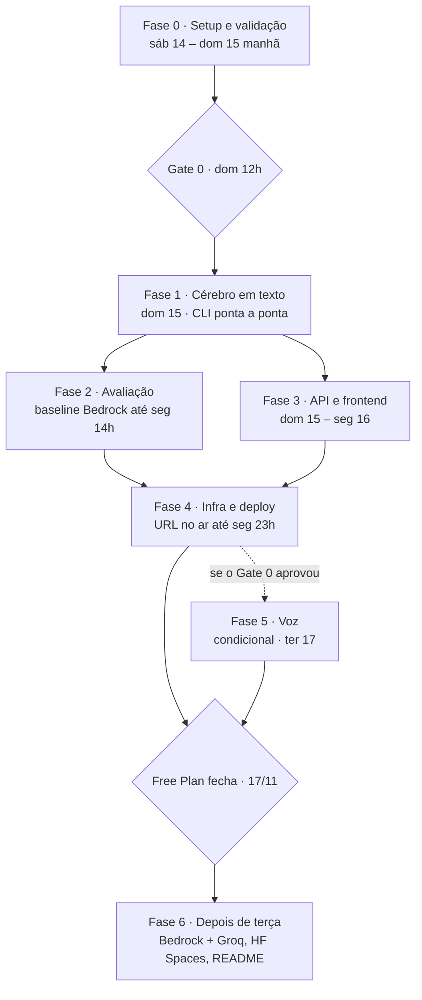

# MIA — Implementation Plan

**MIA — Mock Interview Assistant** · atualizado em 15/11/2026

Documentos relacionados: [PRD](PRD.md) · [TRD](TRD.md) · [App Flow](APP_FLOW.md) · [Backend Schema](BACKEND_SCHEMA.md) · [Design](design/README.md) · [Casos](CASES.md)

> **Atualização de 15/11:** a web virou uma demo pública sem login, com 5 casos prontos e uma tela do recrutador. Mudaram 0.4, 1.3, 1.9, as novas 1.11–1.12, 3.1, 3.4–3.8, 3.10–3.11, 4.1–4.2, 4.5–4.7, 5.5, 6.3 e a ordem de cortes.

## Como usar este plano

Tudo que depende da AWS fica pronto até segunda à noite; terça fica só para vídeo, voz e margem, porque a conta pode fechar a qualquer hora de 17/11. Base: PRD, TRD, App Flow, Backend Schema, Design e Casos em `docs/`.

**Checkpoints**

| Quando | Checkpoint | Se não bater |
| --- | --- | --- |
| Dom 15, 12h | Gate 0 decidido: Bedrock, AgentCore e Sonic testados | Aplicar os planos B do TRD e seguir |
| Dom 15, 23h | Entrevista completa em texto pelo terminal (`mia simulate`) com relatório | Cortar o relatório em LangGraph para uma chamada só |
| Seg 16, 14h | Baseline v1 rodada nos modelos do Bedrock, salva em `runs/` | Rodar só Haiku + Nova; resto depois (Bedrock segue ativo após terça) |
| Seg 16, 23h | Modo texto no ar com URL | Plano B (Lambda + API Gateway) ou demo local gravada |
| Ter 17, manhã | Vídeo de demo gravado; `runs/` e resultados commitados | — (obrigatório) |
| Ter 17, tarde | Voz, se o Gate 0 aprovou | Voz fica fora |

**Regras de trabalho com o agente (Claude Code ou Codex)**

1. Uma tarefa deste plano por pedido, citando o ID (ex.: "implemente a 1.3 seguindo o TRD e o Backend Schema").
2. Peça o plano antes do código nas tarefas grandes e só aprove depois de ler.
3. Cada tarefa termina com o critério "Pronto quando" verificado e um commit.
4. Você revisa todo `terraform apply`, `destroy` e criação de recurso; chaves nunca no chat.
5. Tarefas marcadas **Você** não são delegadas: console, rótulos do golden set, gravação do vídeo.
6. Ao terminar um módulo, peça ao agente para explicar o código; você vai precisar defendê-lo na entrevista.
7. Toda tarefa é quebrada em passos na spec, em número e tamanho proporcionais à tarefa (P, M ou G). O agente faz um passo por vez, para, explica (contexto, o que fez, como, como testar, o que você deve ver) e só segue quando você disser "próximo". Detalhes na seção "Ritmo de trabalho" do `AGENTS.md`.

## Caminho crítico

A Fase 1 é o gargalo: Avaliação e API só começam com o cérebro rodando no terminal. A 4.1 (tabelas e buckets em Terraform) pode adiantar para domingo à noite se a Fase 3 precisar de DynamoDB real.

## Fase 0: setup e validação

Objetivo: descobrir em poucas horas se Bedrock, AgentCore e Sonic funcionam nesta conta, antes de escrever o produto. Termina no Gate 0.

| ID | Tarefa | Quem | Entrega | Pronto quando |
| --- | --- | --- | --- | --- |
| 0.1 | Console AWS: data do fim do Free Plan, MFA no root, usuário IAM `mia-dev`, alertas de Budget, região us-east-1 | Você | Perfil `mia` na AWS CLI | `aws sts get-caller-identity --profile mia` responde |
| 0.2 | Testar Claude Haiku, Nova Lite e Mistral Large 3 no playground do Bedrock. Nota: Llama descartado: Legacy no Bedrock desde 30/09/2026 | Você | — | Os três respondem (ou formulário da Anthropic enviado) |
| 0.3 | Chaves Gemini (AI Studio) e Groq (grátis, sem cartão) | Você | `.env` local | Chaves no `.env`, nunca no git |
| 0.4 | Esqueleto do repositório: `uv`, Ruff, pytest, `.gitignore`, `.env.example`, `docs/` com os 7 documentos (incluindo `CASES.md`), `AGENTS.md` | Agente | Repo `mia/` no GitHub | `uv run pytest` e `uv run ruff check` passam vazios |
| 0.5 | `llm.py` mínimo: `init_chat_model` por config, registro de cada chamada em `runs/*.jsonl` (`RunRecord`) | Agente | `src/mia/llm.py`, `config/models.yaml` | Teste unitário grava um `RunRecord` válido |
| 0.6 | Smoke test de provedores: mesmo prompt em Claude Haiku, Nova Lite, Mistral Large 3 (Bedrock; ID a confirmar na tarefa 0.6), Gemini Flash e gpt-oss-120b (Groq) | Agente | `scripts/smoke_providers.py` | 5 linhas em `runs/` com tokens, latência e custo |
| 0.7 | AgentCore: subir o exemplo oficial de WebSocket (echo) | Você + agente | Runtime de teste | Navegador ou script recebe o eco; runtime apagado depois |
| 0.8 | Sonic em português: rodar o exemplo oficial local por ~15 min, com fone | Você | Notas de latência e qualidade | Decisão registrada: voz entra ou não |

**Gate 0 (dom 12h):** registre em `docs/adr/0001-gate-0.md` o resultado de 0.6, 0.7 e 0.8 e o plano B escolhido para o que falhou.

## Fase 1: cérebro em texto

Objetivo: uma entrevista completa rodando no terminal, sem API nem frontend. Desenvolva com Claude Haiku no Bedrock (`config/models.yaml`); a lógica não muda entre provedores. O Gemini 3.8 Flash saiu do desenvolvimento em 16/11 por falhas frequentes (503, JSON truncado, travamento).

| ID | Tarefa | Quem | Entrega | Pronto quando |
| --- | --- | --- | --- | --- |
| 1.1 | Todos os schemas Pydantic do Backend Schema | Agente | `src/mia/schemas.py` + testes | Testes cobrem limites (nota fora de 1–5, listas vazias) |
| 1.2 | Carregador de prompts: lê `prompts/<nome>/v<N>.yaml`, valida campos, resolve modelo por config | Agente | `src/mia/prompts.py` | Prompt inválido gera erro claro; versão usada vai para o `RunRecord` |
| 1.3 | Prompts v1: `screening`, `planner`, `interviewer`, `follow_up`, `judge`, `report`, `candidate_summary`, `synthetic_candidate` | Você + agente | `prompts/*/v1.yaml` | Cada um usa delimitadores para texto do usuário e aponta seu `output_schema` |
| 1.4 | `pii.py`: e-mail, telefone BR, CPF, URLs pessoais, nome no cabeçalho do CV | Agente | `src/mia/pii.py` + testes | CV de exemplo sai sem nenhum dado pessoal; testes com 10+ casos |
| 1.5 | Pipeline de validação em `llm.py`: saída estruturada, 1 reparo, `json_valid_first_try`, `repaired`; util de citações literais | Agente | `llm.py`, `src/mia/checks.py` | Teste com JSON quebrado registra reparo; citação inventada é detectada |
| 1.6 | `prep_graph.py` (LangGraph): PDF → texto → mascarar → triagem → plano → validar cobertura | Agente | `src/mia/prep_graph.py` | CV fictício em PDF + vaga fictícia geram `Screening` e `InterviewPlan` válidos; nenhum dado real no repositório |
| 1.7 | `interviewer.py`: máquina de estados + ferramentas (`next_question`, `should_follow_up`, `score_answer`, `time_check`, `end_interview`), máx. 2 aprofundamentos | Agente | `src/mia/interviewer.py` + testes | Testes das transições sem LLM (decisões simuladas) |
| 1.8 | `judge.py`: nota com `look_for`, verificação de citações, `quotes_verified` | Agente | `src/mia/judge.py` | Resposta fraca recebe nota baixa com justificativa; citações conferidas |
| 1.9 | `report_graph.py`: garantir notas → agregar por competência → pontos a melhorar → `candidate_summary` (resumo para o recrutador) | Agente | `src/mia/report_graph.py` | `Report` e `CandidateSummary` válidos a partir de uma lista de turnos; `answer_quote` conferido literalmente; resumo sem nome, gênero ou idade |
| 1.10 | CLI `mia simulate --cv --job --persona` com repositório em memória | Agente | `src/mia/cli.py` | Você faz uma entrevista inteira no terminal e recebe o relatório em JSON |
| 1.11 | Os 5 casos da `CASES.md`: `case.yaml`, `cv.md` e `job.md` de cada um (fictícios) | Você + agente | `cases/<case_id>/` | Revisados por você; nenhum dado real |
| 1.12 | `scripts/build_cases.py` (roda o `prep_graph` em cada caso e grava `screening.json` e `plan.json`) + `src/mia/cases.py` (carrega e valida) + `mia simulate --case <id>` | Agente | `scripts/build_cases.py`, `src/mia/cases.py` | Os 5 casos carregam sem chamar modelo; fixtures commitados com `version` |

Os repositórios de dados têm uma interface e duas implementações (memória e DynamoDB); a de memória serve para testes, CLI e a versão do Hugging Face.

## Fase 2: avaliação

Objetivo: a baseline v1 nos modelos do Bedrock salva antes de segunda 14h; iterações v2 podem continuar depois no Bedrock e no Groq. Pode rodar em paralelo com a Fase 3.

| ID | Tarefa | Quem | Entrega | Pronto quando |
| --- | --- | --- | --- | --- |
| 2.1 | Golden set: 10 perguntas (6 técnicas, 4 comportamentais) com `look_for` | Você + agente | `evals/datasets/questions.yaml` | Rubricas revisadas por você |
| 2.2 | Gerar 70 respostas (5 níveis + enrolada + paráfrase) com Groq (gpt-oss-120b) via `synthetic_candidate`, família diferente do juiz (Claude) | Agente | `evals/datasets/judge_golden.jsonl` (sem nota) | 70 itens válidos no schema `GoldenItem` |
| 2.3 | Dar as notas humanas sem ver o juiz; separar dev 70% / teste 30% | **Você** | `human_score` e `split` preenchidos | 70 notas; split estratificado por nível |
| 2.4 | Conjuntos B (~40 momentos de ferramenta), C (vagas + CVs sintéticos) e D (injections) | Agente | `evals/datasets/*.jsonl` | Cada conjunto com `expected` e `split` |
| 2.5 | Promptfoo com custom provider em Python chamando `src/mia` e assertions em Python | Agente | `evals/promptfooconfig.yaml`, `evals/assertions/` | `npx promptfoo eval` roda o conjunto A em um modelo |
| 2.6 | Métricas agregadas: kappa ponderado, erro médio, % ±1, viés de verbosidade, consistência, JSON válido, custo, p95 | Agente | `evals/metrics.py` | Gera `results/<experimento>.md` com as tabelas |
| 2.7 | Baseline v1 no Bedrock: Claude Haiku, Claude Sonnet ou Nova Pro, Mistral Large 3; conjuntos A e B | Agente | `runs/`, `results/baseline_v1.md` | Commitado antes de seg 14h |
| 2.8 | Conjunto D com e sem Bedrock Guardrails, dividida em 2.8a (defesas: prompt attack, poisoning, fora do assunto, PII; guardrail via boto3) e 2.8b (rodada e relatório) | Agente | `config/guardrails.yaml`, `results/robustez_v1.md` | Taxa de ataques que funcionaram nos dois cenários |
| 2.9 | Prompt v2 do juiz ajustado só no split dev; resultado reportado no teste | Você + agente | `prompts/judge/v2.yaml`, `results/judge_v1_vs_v2.md` | Tabela v1 × v2 incluindo o que piorou |
| 2.10 | Conjunto A em modo rápido no CI, com respostas gravadas (sem chamar modelo) | Agente | `tests/test_eval_regression.py` | Roda em menos de 1 min no GitHub Actions |

## Fase 3: API e frontend

Objetivo: o fluxo do App Flow funcionando localmente, da escolha do caso ao relatório e à tela do recrutador, pronto para subir na Fase 4.

| ID | Tarefa | Quem | Entrega | Pronto quando |
| --- | --- | --- | --- | --- |
| 3.1 | Camada de serviço com as 11 operações do Backend Schema (incluindo `list_cases` e as duas do recrutador), usando a interface de repositório; turnos saem como `PublicTurn` antes de `completed` (inclusive em `get_session` durante `in_progress`) | Agente | `src/mia/service.py` | Testes cobrem regras de estado (`invalid_state`, `session_limit`) e garantem que `score` e `decision` nunca saem antes de `completed` |
| 3.2 | FastAPI: rotas REST + `POST /invocations` (despachante por `action`) + `GET /ping`; formato único de erro | Agente | `src/mia/api/` | Mesmo teste passa pelas duas portas de entrada |
| 3.3 | Repositório DynamoDB (`mia-sessions`, `mia-turns`) com `UpdateItem` condicionado ao status | Agente | `src/mia/repo_dynamo.py` | Testes com moto ou tabelas reais de dev |
| 3.4 | Visitante anônimo + cotas: valida `X-Visitor-Id` (UUID v4), `quotas.py` (5/visitante/dia e 100/dia global em `mia-meta`, contador atômico) e kill switch `config/demo.open` | Agente | `src/mia/api/visitor.py`, `src/mia/quotas.py` | Header inválido → `invalid_input`; 6ª sessão → `quota_exceeded`; demo fechada → `demo_paused`; `visitor_id` nunca do corpo |
| 3.5 | `create_session {case_id, mode}`: copia triagem e plano do caso, sessão nasce `ready` e responde 201 sem chamar modelo; `candidate_no` sequencial por caso | Agente | `service.py` | Teste confirma 0 chamadas ao LLM e `candidate_no` sem repetição |
| 3.6 | Frontend React + Vite seguindo o Design (`docs/design/`) (seção 14, blocos 0–6): fundação, Início (casos + histórico), Preparo, Entrevista, Relatório, Recrutador, Candidato | Agente | `frontend/` | As 6 telas navegam com o backend local e cumprem o "Pronto quando" da seção 14 do Design (`docs/design/`) |
| 3.7 | Estados vazios, carregamento e erros do App Flow, com as mensagens da seção 10 do Design (`docs/design/`) | Agente | `frontend/` | Cada linha da seção 10.2 do Design (`docs/design/`) tem tela |
| 3.8 | Teste E2E mínimo com Playwright: escolher caso → 2 respostas → encerrar → relatório → tela do recrutador, usando os `data-testid` da seção 14 do Design (`docs/design/`) | Agente | `frontend/e2e/` | Passa localmente com modelo barato |
| 3.9 | Container ARM64 do backend (AgentCore exige ARM64; confirmar no Gate 0) | Agente | `Dockerfile` | `docker run` local responde em `/ping` e `/invocations` |
| 3.10 | `recruiter.py`: média do caso (só com ≥ 3 concluídas, via GSI `by_case`), filtro acima da média, `delta_vs_case_avg`, `is_above_case_avg` no relatório | Agente | `src/mia/recruiter.py` + testes | Testes com 0, 2, 3 e 10 sessões; nenhum campo do visitante na resposta |
| 3.11 | Lambda proxy: rota REST → `action`, valida `X-Visitor-Id`, chama o AgentCore com SigV4 | Agente | `proxy/handler.py` + testes | Teste local com evento do API Gateway gera a chamada certa ao AgentCore (mock) |

## Fase 4: infraestrutura e deploy

Objetivo: modo texto no ar com URL até segunda 23h, tudo em Terraform. Comece a 4.1 cedo (segunda de manhã): tabelas e bucket reais também servem para a Fase 3.

| ID | Tarefa | Quem | Entrega | Pronto quando |
| --- | --- | --- | --- | --- |
| 4.1 | Terraform base (state local): DynamoDB × 3 (`mia-sessions` com GSI `by_case`, `mia-turns`, `mia-meta` com TTL), S3 dados (ciclo de vida 30 dias), ECR, SSM SecureString, IAM por componente, Budgets | Agente + revisão sua | `infra/` | `terraform plan` limpo; `apply` revisado por você |
| 4.2 | API Gateway HTTP API (throttling 5 req/s, burst 10, CORS só do CloudFront) + Lambda proxy da 3.11 | Agente + revisão sua | `infra/api.tf` | `curl` com `X-Visitor-Id` chega no proxy; sem header → 400 |
| 4.3 | Bedrock Guardrail (prompt attack + PII) em Terraform | Agente | `infra/guardrail.tf` | ID do guardrail lido por config |
| 4.4 | Build e push da imagem ARM64 para o ECR | Agente | `scripts/push_image.sh` | Imagem no ECR com tag do commit |
| 4.5 | AgentCore Runtime + endpoint em Terraform, com autenticação IAM (só a role do proxy invoca) | Agente + revisão sua | `infra/agentcore.tf` | Proxy invoca com sucesso; chamada sem SigV4 é recusada |
| 4.6 | Frontend: S3 privado + CloudFront; build e upload | Agente | `infra/web.tf`, `scripts/deploy_web.sh` | URL do CloudFront abre o Início com os 5 casos |
| 4.7 | Teste de fumaça na URL: três simulações do mesmo caso + tela do recrutador; testar `demo.open=false` | Você | — | Relatório e resumo gerados em produção; média aparece; kill switch pausa a demo; custo em `runs/` |
| 4.8 | CI no GitHub Actions: Ruff, pytest, eval rápido, `terraform plan`; deploy via OIDC se der tempo | Agente | `.github/workflows/` | PR mostra os checks verdes |
| 4.9 | Gravação do vídeo de demo (2–3 min) e commit de `runs/` e `results/` | **Você** | Vídeo + commit | Feito até terça de manhã |

**Plano B (se o AgentCore falhou no Gate 0):** trocar 4.5 por Lambda com FastAPI (Lambda Web Adapter) atrás do mesmo API Gateway; o proxy da 3.11 deixa de ser necessário. O mesmo container e a mesma camada de serviço.

## Fase 5: voz (condicional)

Só começa se o Gate 0 aprovou o Sonic e a Fase 4 está no ar. Se a URL de voz não ficar pronta, uma demo local gravada já serve como evidência.

| ID | Tarefa | Quem | Entrega | Pronto quando |
| --- | --- | --- | --- | --- |
| 5.1 | Cliente do Nova 2 Sonic adaptado do exemplo oficial: sessão, prompt do entrevistador, voz em português | Agente | `src/mia/voice/sonic.py` | Conversa local pelo terminal funciona |
| 5.2 | Ligar as ferramentas do `interviewer.py` ao Sonic; `score_answer` em segundo plano | Agente | `src/mia/voice/tools.py` | Entrevista por voz segue o plano e grava turnos em texto |
| 5.3 | Endpoint WebSocket `/ws` com o protocolo de eventos do Backend Schema | Agente | `src/mia/api/ws.py` | Script de teste troca eventos e recebe `transcript` |
| 5.4 | Front: captura PCM 16 kHz (AudioWorklet), reprodução, interrupção, transcrição ao vivo, fallback para texto (estados da seção 8 do Design (`docs/design/`)) | Agente | `frontend/src/voice/` | Conversa no navegador com fone |
| 5.5 | Rota `POST /sessions/{id}/voice-url` no proxy: confere o `visitor_id` dono da sessão e devolve a URL SigV4 do WebSocket (5 min) | Agente | `proxy/handler.py`, `infra/api.tf` | Front conecta em produção |
| 5.6 | Gravação da demo de voz | **Você** | Vídeo | Gravado antes de a conta fechar |

## Fase 6: depois de terça

Sem prazo. A conta AWS continua ativa (paga) depois de terça: o cérebro segue no Bedrock (Claude Haiku), com Groq e Gemini só na comparação. É aqui que o projeto vira portfólio.

| ID | Tarefa | Quem | Entrega | Pronto quando |
| --- | --- | --- | --- | --- |
| 6.1 | Iterações v2/v3 dos prompts no Bedrock; comparação entre provedores (Bedrock, Groq, Gemini) | Você + agente | `results/*.md` | Tabela com todos os modelos testados, incluindo os do Bedrock salvos antes |
| 6.2 | Red-team do Promptfoo no conjunto D | Agente | `results/redteam.md` | Taxa de ataques que funcionaram por categoria |
| 6.3 | Versão permanente no Hugging Face Spaces: modo texto, os 5 casos, repositório em memória, Claude Haiku no Bedrock, mesmas cotas | Agente | Space público | Recrutador consegue fazer uma simulação pelo link |
| 6.4 | README: objetivo, arquitetura, método, resultados, limitações, modelo de ameaças, vídeo | Você + agente | `README.md` | Explicável em 2 minutos com números |
| 6.5 | ADRs finais e `docs/guia-de-prompts.md` com o que funcionou e o que piorou | Você | `docs/` | Uma decisão por arquivo, com suas palavras |
| 6.6 | Bullets do currículo e pitch de 2 minutos | Você | CV atualizado | Números reais em cada bullet |

## Ordem de cortes se atrasar

Corte de cima para baixo, só até voltar ao checkpoint. Os itens protegidos nunca saem: são o que a vaga pede e o que o currículo vai citar.

1. Langfuse (fica só JSONL + CloudWatch).
2. Voz inteira (Fase 5).
3. Deploy automático no CI (deploy manual por script; CI de PR continua).
4. Teste E2E com Playwright (3.8).
5. Relatório em LangGraph vira uma chamada única ao LLM.
6. Tela Candidato (6.8 do Design): o recrutador fica só com a lista e a headline; `candidate_summary` continua sendo gerado.
7. Conjunto D com Guardrails (fica só a versão sem Guardrails, depois de terça).

**Protegidos:** conjunto A com nota humana e tabela v1 × v2; comparação entre modelos; `runs/` em JSONL; modo texto no ar com URL; os 5 casos; cotas e kill switch; Terraform; vídeo de demo.
