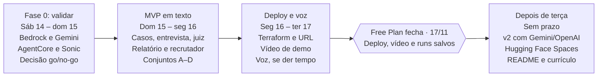

# MIA — PRD

**MIA — Mock Interview Assistant** · Documento de requisitos de produto · atualizado em 15/11/2026

Documentos relacionados: [TRD](TRD.md) · [App Flow](APP_FLOW.md) · [Backend Schema](BACKEND_SCHEMA.md) · [Design](DESIGN.md) · [Casos](CASES.md)

## Visão geral

MIA (Mock Interview Assistant) é um simulador de entrevistas de emprego com IA. Na web, qualquer pessoa escolhe um de 5 casos prontos (uma vaga e um candidato fictício), faz a entrevista no papel desse candidato e recebe um relatório com nota por competência e evidências tiradas da própria fala. Do outro lado, uma tela do recrutador mostra, de forma anônima, quem ficou acima da média de cada caso, com um resumo do desempenho.

**Problema.** Candidatos de tecnologia treinam entrevistas sem feedback objetivo. Simuladores genéricos não leem a vaga, não aprofundam nos pontos fracos do candidato e dão notas sem justificativa verificável. Recrutadores, por sua vez, recebem pouca evidência concreta de como alguém respondeu.

**Proposta.**

- **Candidato:** cada caso já tem a triagem do "recrutador simulado" (forças, pontos de atenção) e um plano de entrevista que mira esses pontos. O entrevistador conduz a conversa seguindo o plano. Um juiz calibrado com nota humana avalia cada resposta com base nos critérios definidos antes da entrevista.
- **Recrutador:** vê, por caso, quem ficou acima da média, com um resumo baseado só nas respostas, pontos fortes e de atenção com trechos literais e uma sugestão de próximo passo (apoio à decisão, não decisão).
- **Sem atrito:** nada de cadastro, login ou upload. O visitante entra, escolhe um caso e começa.

**Contexto.** O MIA é também um projeto de portfólio para vagas de Prompt Engineer e AI Engineer (primeira alvo: vaga de Prompt Engineer Jr). Quem avalia o portfólio consegue testar os dois lados em poucos minutos. Por isso, avaliação, versionamento de prompts e portabilidade entre provedores são requisitos de produto, não detalhes de implementação.

## Objetivos e não-objetivos

**Objetivos**

1. Entregar uma IA em produção: deploy na AWS com URL pública e infraestrutura reprodutível em Terraform, antes do fim do Free Plan.
2. Deixar a demo testável em menos de 1 minuto, sem login: escolher caso → entrevista → relatório → tela do recrutador.
3. Gerar feedback confiável: notas do juiz com concordância medida contra a nota humana e evidências que existem literalmente na resposta.
4. Provar engenharia de prompts com números: prompts versionados, experimentos v1 × v2 em conjunto fixo, comparação entre modelos (qualidade, custo, latência), incluindo o que piorou.
5. Funcionar com qualquer provedor: Bedrock, Gemini e OpenAI pela mesma camada (LangChain), sem mudar a lógica do app.
6. Manter o custo sob controle numa demo aberta: cotas diárias e interruptor para pausar.
7. Manter uma versão permanente no ar depois que a conta AWS fechar.

**Não-objetivos**

- Contas de usuário, login, cadastro ou cobrança.
- Upload de CV e vaga na web (fica só na CLI local, para o dono).
- RAG (já demonstrado no projeto LARA).
- Fine-tuning de modelos.
- Armazenar áudio bruto da voz.
- Decisão automática de contratação: o recrutador sempre decide.
- Simular entrevistas de outras áreas além de tecnologia/IA.

## Usuários e cenários de uso

| Usuário | Como entra | O que faz | O que quer sair sabendo |
| --- | --- | --- | --- |
| Visitante no papel de candidato | Abre a URL, sem login | Escolhe um dos 5 casos e faz a entrevista | Como se saiu em cada competência, com evidência, e o que melhorar |
| Visitante no papel de recrutador | Abre a tela do recrutador, sem login | Vê quem ficou acima da média de cada caso | Quem vale a próxima etapa e por quê, com trechos das respostas |
| Dono do projeto | CLI local | Simula com o próprio CV e a vaga real; roda as avaliações | Se está pronto para a entrevista real; números para o README |

Os 5 casos (detalhes em `CASES.md`) cobrem os três tipos de entrevista (RH, técnica, gestão) e três níveis (estágio, júnior, pleno). Cada visitante pode fazer até 5 simulações por dia.

## Jornada do usuário

**Candidato** (o critério de avaliação é definido antes e reaproveitado no feedback):

1. **Escolher**
    1. O visitante vê os 5 casos (vaga, nível, tipo de entrevista, quem vai interpretar) e escolhe um.
    2. Aceita o aviso: as respostas ficam anônimas e podem aparecer na tela do recrutador.
2. **Preparar**
    1. Vê a triagem pronta do caso: aderência (0–100), forças e pontos de atenção com trechos do CV fictício, competências avaliadas. As perguntas ficam escondidas.
3. **Entrevistar**
    1. Conversa em texto (MVP) ou voz (camada final), uma pergunta por vez.
    2. O entrevistador decide quando aprofundar e quando avançar, respeitando fases e tempo.
    3. O visitante pode encerrar a qualquer momento.
4. **Receber feedback**
    1. Relatório com nota por competência (1–5), critérios atendidos e trechos da fala como evidência.
    2. Pontos a melhorar e sugestão de resposta mais forte.
    3. Se ficou acima da média do caso, um link para ver como o recrutador o vê.
    4. Histórico das simulações feitas neste navegador.

**Recrutador:**

1. Abre a tela do recrutador e escolhe um caso (ou todos).
2. Vê a média do caso e a lista de candidatos anônimos acima dela, do mais acima para o menos.
3. Abre um candidato: resumo, pontos fortes e de atenção com trechos literais, notas por competência, sugestão de próximo passo e a transcrição.

## Escopo

O MVP é o modo texto completo com os casos e a tela do recrutador; a voz é uma camada por cima que só entra se o teste da fase 0 passar.

| Camada | Inclui | Condição |
| --- | --- | --- |
| MVP: candidato | 5 casos com triagem e plano prontos, entrevista em texto com ferramentas, juiz, relatório, histórico do navegador | Obrigatório |
| MVP: recrutador | Lista por caso acima da média, detalhe com resumo e transcrição | Obrigatório |
| MVP: controle da demo | Visitante anônimo, cotas diárias, interruptor, throttling | Obrigatório |
| Avaliação | Conjuntos A–D, tabelas v1 × v2, comparação entre modelos | Obrigatório |
| CLI local | Simulação com CV e vaga próprios, geração das fixtures dos casos | Obrigatório |
| Voz | Nova 2 Sonic usando as mesmas ferramentas do modo texto | Só se o Sonic em português passar na fase 0 e houver tempo antes de terça |
| Inglês | Casos e entrevista em inglês (idioma já é parâmetro) | Depois do MVP |
| Versão permanente | Modo texto no Hugging Face Spaces com Gemini | Depois de terça |

**Fora de escopo:** login, contas, upload na web, RAG, fine-tuning, áudio armazenado, WebRTC, app mobile.

## Requisitos funcionais

| ID | Requisito | Prioridade |
| --- | --- | --- |
| RF-01 | Listar os 5 casos com vaga, empresa fictícia, nível, tipo de entrevista, quem o visitante interpreta e duração estimada | MVP |
| RF-02 | Identificar o visitante por um id anônimo do navegador, sem login | MVP |
| RF-03 | Criar uma sessão a partir de um caso, já pronta (triagem e plano copiados do caso, sem chamar modelo) | MVP |
| RF-04 | Mostrar a triagem do caso: aderência, forças e pontos de atenção com citação do CV, palavras-chave faltando, competências | MVP |
| RF-05 | Conduzir a entrevista em texto, uma pergunta por vez, seguindo as fases do plano | MVP |
| RF-06 | Decidir a cada resposta entre aprofundar ou avançar, via ferramenta | MVP |
| RF-07 | Mascarar dados pessoais de tudo que o visitante digita antes de salvar ou enviar a um modelo | MVP |
| RF-08 | Dar nota 1–5 a cada resposta usando os `lookFor` do plano, com critérios atendidos e citações literais | MVP |
| RF-09 | Gerar relatório final: notas por competência, evidências, pontos a melhorar | MVP |
| RF-10 | Gerar, no fim da avaliação, um resumo do candidato para o recrutador, baseado só nas respostas | MVP |
| RF-11 | Listar as simulações feitas neste navegador e a evolução das notas | MVP |
| RF-12 | Tela do recrutador: por caso, média e candidatos anônimos acima dela | MVP |
| RF-13 | Detalhe do candidato: resumo, forças e pontos de atenção com trechos, notas, sugestão de próximo passo, transcrição | MVP |
| RF-14 | Limitar sessões por dia (5 por visitante, 100 no total) e permitir pausar a demo | MVP |
| RF-15 | Avisar o visitante, antes de começar, que as respostas ficam anônimas e podem aparecer para o recrutador; permitir apagar a própria sessão | MVP |
| RF-16 | CLI local: simular com CV e vaga próprios e gerar as fixtures dos casos | MVP |
| RF-17 | Conduzir a mesma entrevista por voz em tempo real, com interrupção | Voz |
| RF-18 | Casos e entrevista em inglês | Depois do MVP |

## Requisitos não funcionais

Os valores abaixo são metas iniciais; a fase 0 mede os reais e ajusta.

| ID | Categoria | Requisito |
| --- | --- | --- |
| RNF-01 | Latência | Criar sessão a partir de caso: abaixo de 1 s. Resposta do entrevistador em texto: p95 abaixo de 3 s. Voz: p95 do turno abaixo de 1,5 s |
| RNF-02 | Custo | Custo por sessão medido; cotas garantem teto diário; gasto total dentro dos créditos AWS restantes |
| RNF-03 | Privacidade (LGPD) | Sem login nem dados de cadastro; CVs fictícios; respostas mascaradas; recrutador vê só "Candidato N"; nunca áudio; dados reais nunca enviados a planos gratuitos que treinam com os dados |
| RNF-04 | Segurança | Todo texto digitado é tratado como dado não confiável; injection não altera nota, resumo nem instruções |
| RNF-05 | Abuso | Throttling no API Gateway, cotas diárias no DynamoDB, limites por sessão, interruptor da demo |
| RNF-06 | Justiça | Resumo e nota baseados só nas respostas; sem atributos pessoais; mesmo plano para todos de um caso |
| RNF-07 | Portabilidade | Trocar de provedor (Bedrock, Gemini, OpenAI) é só configuração |
| RNF-08 | Consistência | Toda saída de LLM validada por schema; taxa de JSON válido na primeira tentativa medida |
| RNF-09 | Reprodutibilidade | Infra 100% em Terraform; fixtures dos casos e saídas brutas dos experimentos versionadas no repositório |
| RNF-10 | Rastreabilidade | Cada chamada registra prompt, versão, modelo, tokens, latência e custo |
| RNF-11 | Custo parado | Nenhum recurso cobrado por hora parada (sem ALB, NAT Gateway ou instâncias ligadas) |

## Métricas de sucesso

O projeto é bem-sucedido quando cada linha abaixo tem um número real no README, inclusive as que pioraram entre v1 e v2. As metas serão fixadas depois da primeira rodada (baseline).

| Métrica | Como medir | Conjunto |
| --- | --- | --- |
| Concordância juiz × humano | Kappa ponderado, erro médio, % dentro de ±1 ponto, no split de teste | A |
| Citações verificáveis | % de `evidence_quotes` e `answer_quote` que aparecem literalmente na resposta | A |
| Viés de verbosidade | Nota do juiz menos nota humana nas respostas "enroladas" | A |
| Consistência | Variação da nota em 3 execuções e entre paráfrases | A |
| Acurácia de ferramentas | % de momentos com a ferramenta e os argumentos certos | B |
| Qualidade do plano | % dos 5 casos com schema válido, cobertura da vaga e perguntas mirando a lacuna | C |
| Robustez | % de ataques de injection que alteraram nota, resumo ou comportamento | D |
| Resumo sem dados pessoais | % de resumos que passam na checagem de atributos pessoais | D |
| JSON válido | % na primeira tentativa, por prompt e por modelo | Todos |
| Custo e latência | US$ por sessão e p95 por modelo | Todos |
| Produto no ar | URL pública funcionando nos dois lados + vídeo de demo gravado antes do fim do Free Plan | — |

## Premissas, restrições e riscos

**Restrições.** A conta AWS está no Free Plan e fecha na terça (17/11); sem upgrade. Orçamento: créditos AWS restantes + US$ 5 de OpenAI + free tiers de Gemini e Groq. Um desenvolvedor, nível júnior.

**Premissas.** Bedrock responde no Free Plan com cota maior que zero; Gemini free tier tem limite suficiente para os conjuntos de avaliação; o dono rotula manualmente o golden set e revisa os 5 casos.

| Risco | Impacto | Mitigação |
| --- | --- | --- |
| Bedrock com cota zero ou bloqueado no Free Plan | Alto | Testar no primeiro passo; cérebro roda com Gemini/OpenAI e a AWS fica só para deploy |
| AgentCore indisponível no Free Plan | Médio | Modo texto em Lambda + API Gateway; voz só em demo local gravada |
| Demo aberta consome os créditos (abuso ou viralização) | Alto | Cotas de 5/visitante e 100/dia, throttling, limites por sessão, interruptor, alertas de Budget |
| Visitante digita dado pessoal ou ofensivo | Médio | Mascaramento, aviso antes de começar, Guardrails no Bedrock, apagar sessão |
| Resumo do recrutador enviesado ou inventado | Médio | Só respostas como entrada, trechos verificados, checagem de atributos pessoais, sugestão como apoio |
| Sonic fraco em português ou latência alta a partir de SP | Baixo | Voz sai do escopo sem afetar o MVP |
| Créditos acabam antes de terça (conta fecha) | Alto | Alertas de Budget; nada cobrado por hora parada |
| Prazo curto com várias tecnologias novas | Alto | Ordem por dependência da AWS; voz por último; cortes definidos no plano |
| URL some quando a conta fechar | Médio | Vídeo de demo + versão permanente no Hugging Face Spaces |
| Juiz enviesado ou que "decora" o golden set | Médio | Modelos de famílias diferentes para gerar e julgar; split dev/teste; nota humana antes de ver a do juiz |

## Marcos e prazos

A ordem segue a dependência da AWS: o que usa Bedrock, AgentCore ou Sonic precisa estar pronto, gravado e salvo em JSONL antes de terça. O que roda com Gemini/OpenAI continua depois, sem prazo.
