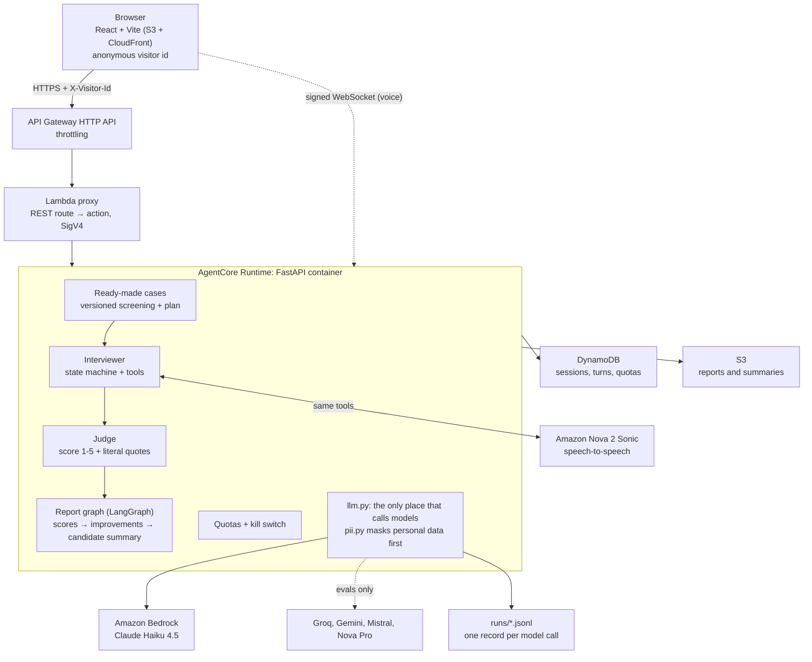

# Architecture

MIA keeps a **portable Python core** (prompts, state machine, judge, report) separate from an
**AWS shell** (API Gateway, Lambda, Bedrock AgentCore Runtime, DynamoDB, S3, CloudFront).
The core runs the same way from the CLI, from a local FastAPI server, or inside the AWS runtime.

> The AWS demo ran until 2026-11-17, when the account was closed. Everything below still runs
> locally; see [running-locally.md](running-locally.md).

## System view

The browser never holds AWS credentials. It calls API Gateway, which throttles and forwards to a
Lambda proxy. The proxy validates the `X-Visitor-Id` header (UUID v4), maps the REST route to an
`action` of the runtime's `/invocations` contract and signs the call with IAM (SigV4). For voice,
the proxy checks that the visitor owns the session and returns a signed WebSocket URL valid for
5 minutes (`POST /sessions/{id}/voice-url`).

## Three flows

| Flow | When | What happens |
| --- | --- | --- |
| Offline preparation | Once per case, by the developer | `scripts/build_cases.py` runs the LangGraph prep graph (extract CV → mask PII → screening → interview plan → coverage check) on 5 fictitious CV + job pairs. The output is reviewed and committed under `cases/`. Creating a web session never calls a model. |
| Real-time interview | Every answer | The interviewer state machine decides the next move with deterministic rules and asks the model only to *write* the line. The judge scores each answer in the background. In voice mode Nova 2 Sonic speaks and listens, but the code still decides when an answer ends and what comes next. |
| Asynchronous report | End of the session | The report graph makes sure every answer has a score, aggregates them, writes improvement points and an anonymous candidate summary for the recruiter screen. |

The CLI (`mia simulate`) runs the same prep graph on any fictitious CV + job, then the same
interview loop in the terminal.

## Core modules (`src/mia/`)

| Module | Responsibility |
| --- | --- |
| `llm.py` | The **only** module that imports a provider SDK (LangChain `init_chat_model`). Picks the model from `config/models.yaml`, retries, validates the output against a Pydantic schema, writes a `RunRecord` to `runs/*.jsonl`. |
| `schemas.py` | Pydantic models for every model output (`Screening`, `InterviewPlan`, `AnswerScore`, `Report`, `CandidateSummary`, ...). No loose dicts. |
| `prompts.py` | Loads `prompts/<name>/v<N>.yaml`. A prompt used in an experiment is never edited; a new version is created with a changelog. |
| `pii.py` | Masks names, emails, phones, CPF and personal links in everything the visitor types, before any model call. |
| `prep_graph.py` | LangGraph: CV → screening → plan. Used offline for the cases and by the CLI. |
| `interviewer.py` | State machine (phase, current question, time, turn limit) and tools: next question, follow-up, score, time check, end. |
| `judge.py` | 1-5 score against the question's `look_for` criteria; every evidence quote must exist **literally** in the answer, checked in code. |
| `report_graph.py` | LangGraph report: scores → aggregate → improvements → candidate summary. |
| `quotas.py` | Kill switch (item `config/demo` in `mia-meta`), 100 sessions/day global, 5/visitor/day, candidate numbering per case. |
| `recruiter.py` | Per-case average, candidates above it, anonymous detail. Never exposes `visitor_id`. |
| `service.py` | Use cases behind the API; every session operation filters by `visitor_id`. |
| `repositories.py`, `repo_dynamo.py`, `repo_s3.py` | Each store has an interface, an in-memory implementation (tests, local server) and an AWS one. |
| `voice/sonic.py` | Nova 2 Sonic bidirectional stream, adapted from the official AWS sample. |
| `api/` | FastAPI app: REST for text, `/ws` for voice, `/invocations` for AgentCore, `dev.py` for local use. |

## Design rules

1. **The model writes; the code decides.** State transitions, limits, follow-up rules, quote
   checks and the end of a voice answer are deterministic. The voice prompt v2 exists because
   letting Sonic decide when to submit an answer stalled the interview
   ([prompt-guide.md](prompt-guide.md)).
2. **One door to the models.** Swapping Bedrock for Groq or Gemini is a line in
   `config/models.yaml`; `tests/test_prompt_models_guard.py` keeps every prompt routed.
3. **Everything measured.** Every call is a JSON line with prompt version, model, tokens,
   latency, cost and whether the JSON was valid. All metrics in [evaluation.md](evaluation.md)
   come from these records, so they outlive the AWS account.
4. **Nothing billed while idle.** AgentCore, Lambda, on-demand DynamoDB, S3 and CloudFront.
   No load balancer, no NAT gateway, no running instances.

## Data

| Store | Key | Content |
| --- | --- | --- |
| DynamoDB `mia-sessions` | `visitor_id` / `session_id`, GSI by case | case, candidate number, status, aggregate scores |
| DynamoDB `mia-turns` | `session_id` / `turn_no` | question, answer text, tool decision, score |
| DynamoDB `mia-meta` | `pk` / `sk`, TTL | daily quotas, candidate counters, kill switch |
| S3 | `sessions/<session_id>/` | report and candidate summary (JSON), deleted after 30 days |
| `cases/` (git) | `case_id` | fictitious CV and job, generated screening and plan |
| `runs/*.jsonl` (git) | one line per call | masked input, output, tokens, latency, cost. Production records hold visitor text, so they stay out of git; only their aggregates are published ([results/production_summary.md](../results/production_summary.md)). |

No audio is stored, only the text transcript.

## Infrastructure

Terraform in `infra/` (us-east-1): ECR, AgentCore runtime + endpoint, API Gateway HTTP API with
throttling, Lambda proxy, S3 + CloudFront (origin access control), three on-demand DynamoDB
tables, an S3 lifecycle rule, an SSM SecureString parameter, a Bedrock Guardrail, least-privilege
IAM roles per component and an AWS Budget alert.

CI (GitHub Actions, `.github/workflows/ci.yml`) runs on every pull request: Ruff lint and format,
pytest with no secrets and no model calls, a replay of recorded judge answers on eval set A, and
`terraform fmt` + `validate`.

## What was planned and cut

- **Langfuse tracing:** first item of the cut list; JSONL + CloudWatch were enough.
- **Bigger model for reports:** Claude Haiku 4.5 handles every production prompt.
- **Bedrock Guardrails in production:** provisioned and measured on the attack set
  ([security.md](security.md)), but never wired to production prompts: only the evals pass it to
  `llm.py`. Turning it on would have changed measured behaviour, and Haiku alone already
  resisted every attack in the set (spec 4.3).

Decisions and their trade-offs: [adr/](adr/README.md).
