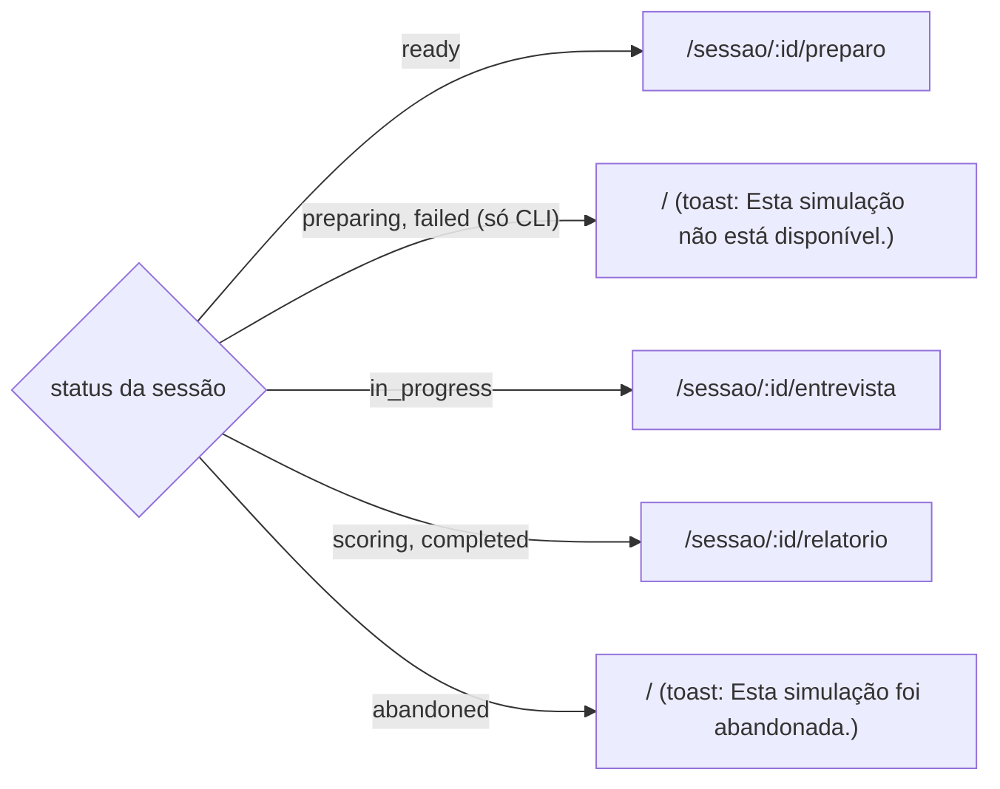
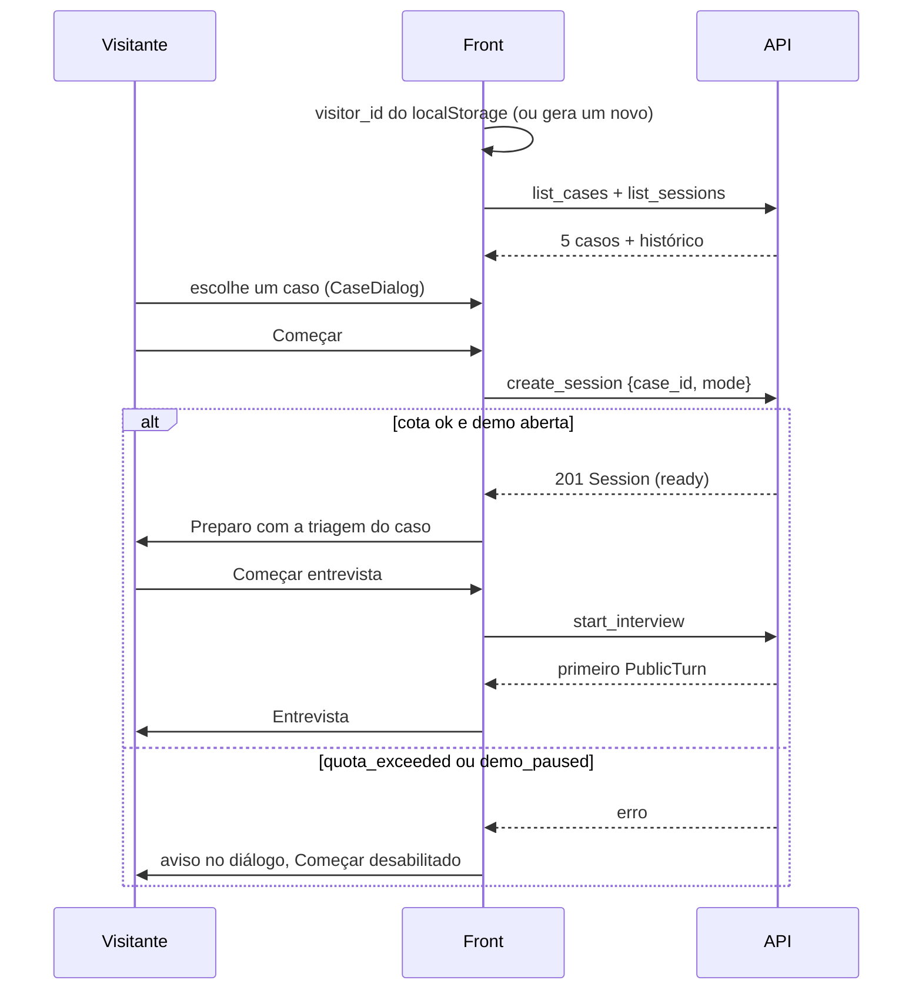
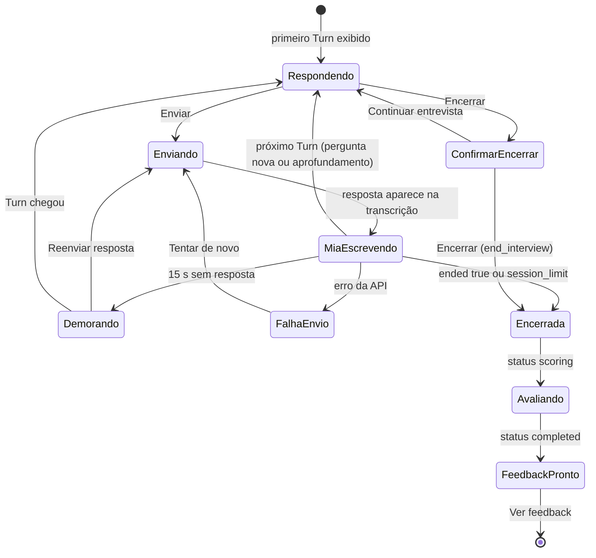
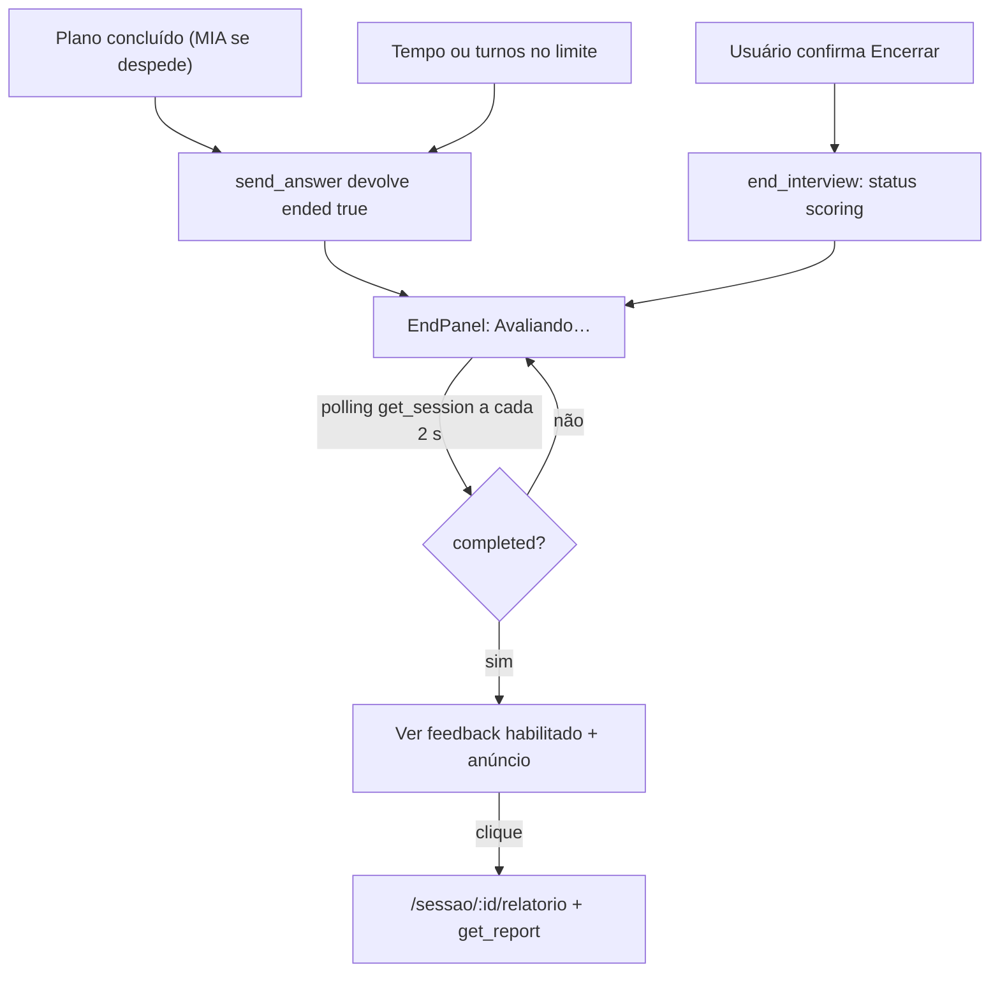

# Design — Fluxos, modo voz e regras de exibição (seções 7–9)

Parte do [Design](README.md). Seções numeradas como no índice.

## 7. Fluxos de interação

### 7.1 Roteamento por status

Toda tela com `:id` busca a sessão ao abrir e redireciona se o status não for o dela. Use uma função única, `routeForStatus(status, id)`.



Exceção: a Entrevista continua na própria rota quando o status muda para `scoring` ou `completed` por causa do encerramento, para mostrar o EndPanel.

### 7.2 Escolha do caso e início da entrevista



Regras de polling (valem para o `scoring` no EndPanel e no Relatório):

- Intervalo de 2 s; o polling para ao sair da tela e pausa com a aba oculta (`visibilitychange`).
- Depois de 3 falhas de rede seguidas: InlineNotice `danger` "Sem conexão com o servidor. Tentando de novo…". O intervalo passa a 5 s e o aviso some na primeira resposta boa.

### 7.3 Loop da entrevista (modo texto)



Um aprofundamento chega como um `Turn` comum, com o mesmo `question_id`. Na tela, não muda nada: sem divisória, sem etiqueta e com o contador parado.

### 7.4 Encerramento e abertura do relatório



---

## 8. Modo voz (só se a voz entrar no escopo)

A voz troca só a entrada e a saída. A transcrição, o cabeçalho, o Encerrar e o EndPanel são os mesmos do modo texto. O AnswerComposer é substituído pela VoiceBar.

```
┌──────────────────────────────────────────────────────────────┐
│ (●) MIA · ENTREVISTA TÉCNICA          Pergunta 3 · 12:41  Encerrar │
├──────────────────────────────────────────────────────────────┤
│   … transcrição ao vivo (mesmo visual do modo texto) …        │
│   VOCÊ                                                        │
│   Montei um conjunto de 50 perguntas e…   ← parcial, itálico  │
├──────────────────────────────────────────────────────────────┤
│ (MIA 64 listening)  Sua vez. Pode falar.          ( mic )     │  ← VoiceBar 96px
└──────────────────────────────────────────────────────────────┘
```

**VoiceBar:** altura de 96 px, fundo `background` e borda superior `border`. MiaMark de 64 px e texto de status (`text-body`, `role="status"`) à esquerda, MicButton à direita. No celular, o MiaMark de 96 px fica centralizado acima, com o texto e o botão embaixo.

**MicButton:** circular, 56 px, borda de 1 px, ícone de 24 px e `aria-pressed` para indicar se está silenciado.

| Estado | Visual | `aria-label` |
| --- | --- | --- |
| Microfone aberto | Fundo `mia-muted`, borda `mia`, ícone `Mic` `mia` | "Silenciar microfone" |
| Silenciado | Fundo `danger-muted`, borda `danger`, ícone `MicOff` `danger` | "Ativar microfone" |
| Indisponível (conectando) | Borda `border-strong`, ícone `muted-foreground`, `aria-disabled` | "Microfone indisponível" |

**Estados da sessão de voz:**

| Estado | Gatilho (evento) | MiaMark | Texto de status |
| --- | --- | --- | --- |
| Pedindo microfone | Clique em "Começar entrevista" | `idle` | "Permita o acesso ao microfone para começar." |
| Microfone negado | Permissão recusada | — | InlineNotice `danger`: "O microfone está bloqueado. Libere o acesso nas configurações do navegador ou continue por texto." + "Continuar em texto" e "Tentar de novo" |
| Conectando | Abrindo o WebSocket / `session.start` | `thinking` | "Conectando…" |
| MIA falando | `audio.output` / `transcript` interviewer | `speaking` | "MIA está falando. Você pode interromper falando por cima." |
| Ouvindo | Fim da fala da MIA | `listening` | "Sua vez. Pode falar." |
| Interrompida | `interrupted` (o front para o áudio na hora) | `listening` | "Pode continuar." (1,5 s, depois "Ouvindo") |
| MIA pensando | Entre a resposta e a próxima fala | `thinking` | "MIA está pensando…" |
| Silenciado | `audio.mute {muted: true}` | `idle` | "Microfone silenciado." |
| Reconectando | Conexão caiu (1 tentativa) | `thinking` | "A conexão caiu. Reconectando…" |
| Voltando para texto | A reconexão falhou | `idle` | InlineNotice `neutral`: "Não foi possível reconectar. Continue por texto a partir da última pergunta." + "Continuar em texto" (troca a VoiceBar pelo AnswerComposer na mesma sessão) |
| Encerrada | `session.ended` | — | EndPanel |
| Erro | `error {code, message}` | — | Toast conforme a seção 10 |

**Transcrição ao vivo:** o texto parcial (`final: false`) aparece em itálico `muted-foreground` e vira o estilo normal quando chega `final: true`. Só as falas finais vão para a região `aria-live`.

---

## 9. Relatório e Início: regras de exibição

### 9.1 Números

| Dado | Formato | Exemplo |
| --- | --- | --- |
| `overall_score`, notas por competência (float) | 1 casa, vírgula: `toLocaleString("pt-BR", {minimumFractionDigits: 1, maximumFractionDigits: 1})` | 3,8 |
| `AnswerScore.score` (int) | "N de 5" | 4 de 5 |
| `fit_score` | Inteiro + "/100" | 72/100 |
| Datas em tabela | `dateStyle: "short"` | 15/11/2026 |
| Datas no relatório | `dateStyle: "long"` | 15 de novembro de 2026 |
| Duração | Minutos inteiros | 18 min |
| Relógio | `mm:ss` | 12:41 |

### 9.2 Gráfico de evolução (Início)

- **O que mostra:** uma série só, a `overall_score` das sessões `completed` em ordem cronológica (no máximo as 20 últimas).
- **Forma:** Recharts `LineChart`, 240 px de altura (200 px no celular), `isAnimationActive={false}`.
- **Linha:** `type="linear"` (não suavizar), `stroke="#8CC7A6"`, `strokeWidth={2}`.
- **Marcadores:** 10 px, preenchimento `#161513` e contorno `#8CC7A6` de 2 px. O formato indica a persona: ● círculo = RH, ■ quadrado = técnica, ▲ triângulo = gestão. O ponto ativo tem 12 px e preenchimento `#8CC7A6`.
- **Eixo Y:** `domain={[1, 5]}`, `ticks={[1,2,3,4,5]}`, largura de 24 px, sem linha de eixo.
- **Eixo X:** data `dd/mm`. Duas sessões no mesmo dia viram "15/11 (2)". Sem linha de eixo.
- **Grade:** só horizontal, `stroke="#2E2B27"`, contínua. Texto dos eixos: IBM Plex Mono 12 px `#A8A196`.
- **Tooltip** (com cursor vertical de 1 px `#403C36`): fundo `#26241F`, borda `#403C36`, raio de 6 px, padding de 8×12 px. Linha 1: `job_title` (peso 500). Linha 2: "Entrevista técnica · 15/11/2026" em `muted`. Linha 3: "Nota geral 3,8".
- **Legenda:** abaixo do gráfico, com os três formatos e os nomes das personas, em `text-small muted`. Ela explica os formatos. Não tem cor por série.
- **Acessibilidade:** o card tem `aria-describedby` apontando para um resumo em texto (`sr-only`): "Nota geral de {n} simulações concluídas, de {mín} a {máx}. Última: {x}." A tabela de sessões logo abaixo serve de visão em tabela dos mesmos dados.
- **Por que não por competência:** as competências são geradas por vaga e mudam de nome entre sessões, então uma linha por competência ficaria quebrada. A evolução por competência aparece só no Relatório, entre tentativas da mesma vaga.
